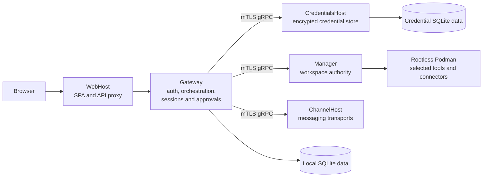

# Kautuka

Kautuka helps families, teams, and businesses use AI helpers for questions, documents, routine workflows, and connected tools. You connect the model you choose, whether from an AI provider or your own computer, and install Kautuka on a computer or server you control. It is an early Apache-2.0 release (v0.1.20); try it with non-critical work first. Our long-term aim is for Kautuka to become the one box a family, team, or business needs.

You choose what each helper can access, and sensitive actions can wait for your approval. Kautuka records activity so you can review what happened; safeguards vary by tool and configuration.

<!-- TODO: Add an approved product screenshot or short demo GIF when one is available. -->

[](LICENSE)
[](https://github.com/devkrity/kautuka/actions/workflows/dotnet-quality.yml)
[](CONTRIBUTING.md#dco-sign-off)

## What Kautuka provides

- **Get help with everyday work:** Set up AI helpers for specific tasks, give them instructions, and review their conversations and results.
- **Choose what helpers can do:** Limit their access to tools and files, and require approval for sensitive actions. Selected tools can run in separate Podman containers.
- **Automate repeatable tasks:** Link steps into a workflow, review its results, and schedule it to run.
- **Use your documents and services:** Give helpers access to workspace files and connect supported services.
- **Manage your installation:** Invite users, connect AI providers, review approvals, and check recent activity.

Capabilities and security controls vary by tool and configuration. See the [security model](docs/architecture/security.md) and [current release notes](https://github.com/devkrity/kautuka/releases) before relying on a specific control.

## Quick start for users

Download a Windows or Linux installer from [Kautuka releases](https://github.com/devkrity/kautuka/releases). If no release is listed, an installer has not been published. Windows requires Windows 10 or later with WSL 2. Linux support is defined by the published release. Allow about 2 GB of memory for Kautuka, plus additional disk space for models, documents, and session data. Agent chat requires Podman.

Before running the Linux installer with `sudo`, verify its GitHub Actions attestation using the command in [release verification](docs/operations/releases.md#linux-installer-verification-before-sudo). Windows Preview installers may be unsigned until Authenticode signing is configured, in which case SmartScreen can display a warning. No live GitHub release has been verified for this release workflow yet.

After installation, open the local address shown by Kautuka, create the first administrator, connect a provider and model, create an agent, and start a session. The [user guide](docs/getting-started.md) describes installation, initial configuration, approvals, and troubleshooting.

## Quick start for developers

From the repository root, run the setup script to install or verify prerequisites, prepare sibling repositories, and restore dependencies:

```bash
./setup_the_world.sh
```

On Windows, run `./setup_the_world.ps1` in PowerShell. Then open the repository in VS Code and press **F5** with **Launch Kautuka**, or run `npm run launch`. See the [developer guide](docs/development/README.md) for version sources, setup options, tests, formatting, and troubleshooting.

## Documentation

- [User getting started](docs/getting-started.md)
- [Developer guide](docs/development/README.md)
- [Documentation index](docs/README.md)
- [System architecture](docs/architecture/system.md)
- [Execution model](docs/architecture/execution.md)
- [Security model](docs/architecture/security.md)
- [Contributing](CONTRIBUTING.md)
- [Security policy](SECURITY.md)
- [Narad Protocol](https://github.com/devkrity/narad) — protocol and TypeScript/React client packages
- [kautuka-auth](https://github.com/devkrity/kautuka-auth) — sign-in service for self-hosted Kautuka installations

## Architecture and security

The browser connects to WebHost and Gateway; Gateway coordinates sessions and approvals, while CredentialsHost protects stored credentials and Manager controls selected Podman workloads. ChannelHost owns messaging transports, and local SQLite databases hold application state. These boundaries limit access between services, but not every tool runs in a sandbox and Podman is not a general network firewall. See the [system architecture](docs/architecture/system.md), [execution model](docs/architecture/execution.md), and [security model](docs/architecture/security.md) for implementation details and limits.



## License

Kautuka is available under the [Apache License 2.0](LICENSE).
