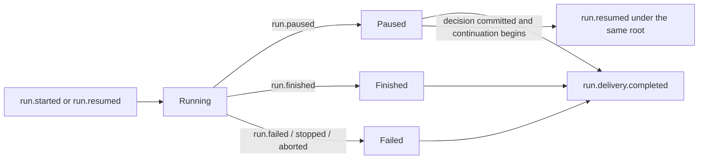

# Execution model

Kautuka treats a run as a durable event-producing state machine. Browser streams, in-memory hubs, and UI state are delivery/projection mechanisms; they are not the run authority.

## Canonical identity

`GatewayRuntimeEvent` carries the run, root run, agent, session, sequence, parent run/tool/session, continuation, checkpoint, resume phase, and optional channel identities needed to reconstruct lineage. Root runtime sequence is positive and strictly increasing.

Canonical event vocabulary includes run start/pause/finish/failure/delivery completion, user and assistant message lifecycle, reasoning, tool lifecycle/results, approval request/resolution, invocation lifecycle, and system/activity facts. The definitions live in `Domain/Models/GatewayModels.cs`. Persistence validates event envelopes and sequences, projection validates supported payload/order, and AAAT continuation separately validates exact relational lineage.

The versioned producer, payload, ordering, privacy, idempotency, and consumer inventory is maintained in the [Narad authority event catalogue](../reference/runtime-events.md) and the normative [Agent Interaction Protocol](../reference/agent-interaction-protocol.md).

The [Agent Interaction Protocol](../reference/agent-interaction-protocol.md) and [Kautuka adoption guide](../reference/agent-interaction-protocol-kautuka-adoption.md) define the current wire mapping, identifiers, replay/reattachment, approval sources, nested sequences, and fail-closed cases.

## Root run lifecycle



A normal delivery records or resumes the user context, streams assistant/reasoning/tool events, commits one paused/finished/failed event, and then commits delivery completion. A continuation is a new delivery under the same root lineage. Stop is a durable server command against the exact agent/session/run. Browser abort is only a local delivery wake-up after the stop command is accepted.

### HITL durable commands

`trustThisRun` and `stopRun` share one authority across `POST /api/narad/v1/commands/resolve-interrupt`, thread commands, channel callbacks, and Narad resume:

- **Bypass (`trustThisRun`)** — staged in the same `GatewayApprovalStore.Resolve` transaction as the approval decision inside `approval_resolution_events` (`trust_this_run`, `bypass_user_id`). The resolution dispatcher applies the durable bypass upsert before publishing the canonical event or allowing continuation. Cleared when the root run reaches a terminal boundary (streaming finally and startup reconciliation). An optional in-process cache may exist; SQLite is authoritative.
- **Stop (`stopRun`, `stop-active-root`)** — staged in the same resolve transaction (`stop_run`, `stop_thread_id`, `stop_channel`, `actor`). The resolution dispatcher applies `IRunStopCommandService` (canonical `run.stop.requested` append) before marking side effects applied, publishing the canonical resolution event, or allowing continuation. The stop body carries audit fields only (`threadId`, `agentId`, `actor`, `channel`, `reason`, …); `runId` / `rootRunId` stay on the Narad envelope — putting reserved envelope keys in the body fails journal validation and blocks stop. `IRunStopRegistry` is a best-effort in-process wake only after the durable journal append; it is not replayed when no in-process execution exists to wake.

There is no process-local bypass registry or direct `RegisterStop` authority on resolution surfaces.

**Continuation gating** — `approval_continuation_jobs` are not leased while the matching `approval_resolution_events` row is unsafe: `status = dead_letter`, `published_at IS NULL`, or (when `stop_run` / `trust_this_run`) `side_effects_applied_at IS NULL`. Continuation proceeds only after canonical `ToolApprovalResolved` publish completes (`published_at` set; dispatcher marks `status = published`). Publish-only and side-effect dead letters block until operator recovery succeeds.

**Operator recovery (forward-only)** — dead-lettered resolution events are listed at `GET /api/runtime/approval-resolution-dead-letters` (AdminDiagnostics). `POST /api/runtime/approval-resolution-dead-letters/{eventId}/retry` resets a dead-letter row to `pending` (clears lease, error, and attempt state) while preserving `side_effects_applied_at` and any other already-applied markers, then synchronously wakes the resolution dispatcher. Retry is idempotent: already-published rows return conflict (`already_published`); already-pending rows return conflict (`already_pending`). This is forward-only recovery — it does not rewrite approval decisions or bypass durable side effects.

## Persistence and delivery

The root agent store allocates run and root sequences, inserts the runtime event, and inserts its outbox record in one transaction. `RuntimeEventPublisher` claims committed outbox records, mirrors nested events to the source/child agent store when required, publishes to the in-process stream hub, and marks delivery. Startup/background recovery discovers pending outbox work.

The live writer subscribes to the root stream, replays committed history, merges live and replayed events, deduplicates by event identity, buffers by root sequence, and rejects cross-root or duplicate-sequence input. Delivery ends only at the projected Narad terminal or canonical `run.delivery.completed` boundary.

## Narad projection

Gateway exposes capabilities, session watch/stream/history, workspace watch, run intents, and thread commands under `/api/narad/v1`.

`GET /api/narad/v1/workspace/watch` and session watch are peer projectors of the same canonical journal plus durable session messages. They preserve contiguous `rootRunId` boundaries in session-history order. `rootRuntimeSequence` orders events only inside one root; it must never be used as a session-wide sort key, because each subsequent root restarts that counter at 1. Pending approvals and interrupts are scoped to their owning root so a finished root cannot hide or block a newer live root on the same session.

Attach validates authentication, agent access, and session ownership before projecting canonical session history. Unresolved approvals are reconstructed only when their request and root pause are both committed. Approvals whose root has already recorded `run.finished` / `run.failed` are dropped so attach can follow a newer live root.

Root assistant content becomes standard Narad message events. Nested child assistant content is inspectable workflow/progress data rather than a second top-level assistant answer. Nested tools retain parent tool-call identity.

Tool completion is accepted only for an exact open tool call that already emitted `tool.call.started`. Framework results with a missing, unknown, or already-completed call ID are logged and discarded at the write boundary; Gateway never manufactures an empty-name system tool to accommodate them. Canonical replay remains strict and rejects orphan or duplicate terminal tool results.

Tool execution failure is a first-class terminal outcome, not a successful result containing error text. A failed framework `FunctionResultContent` becomes a typed `GatewayChatToolFailure` and is persisted as canonical `tool.call.failed` for the exact open call. Its public code is `tool_execution_failed`; its message is deliberately generic. Projection emits Narad `tool.call.finished` with a failure outcome and a versioned JSON content envelope:

```json
{
  "type": "kautuka.tool_failure",
  "version": 1,
  "code": "tool_execution_failed",
  "message": "Tool execution failed."
}
```

The same envelope shape represents other projected failures with their sanitized public code and message. Consumers may format the envelope, but the canonical event remains authoritative.

Cancellation and stop are not failures and are not projected as successful result text. Canonical `tool.call.cancelled` remains the authority and projects as Narad `tool.call.finished` with a strict `kautuka.tool_cancellation` envelope whose code is `cancelled` or `stopped`. The chat renderer treats only that exact versioned envelope as cancelled or stopped; ordinary and lookalike tool results remain ordinary completions.

Before a delivery terminal is committed, Gateway reduces attempts by logical tool name and causal attempt order. If any tool failure is unresolved, the root terminal is `run.failed` with code `tool_execution_failed`; assistant apology or fallback text cannot turn that run into success. Only a successful attempt that started after the failure terminalized is explicit recovery. Completion of a same-name call that was already running concurrently cannot mask the failure. Causal ordinals are reducer state and are not part of session or Narad transport; persisted continuation falls back to recorded start/completion times and requires a strictly later start, failing closed on missing or tied times.

## HITL pause boundary

Channel workflow review cards are built by Gateway from the saved workflow step and its changed output fields. ChannelHost renders the title, bounded fields, and the review actions for each provider. The card omits the user's run message and raw workflow arguments; open Kautuka's Approvals page for full details. Approving continues to the next step, requesting changes reruns the step, and stopping ends the workflow.

Workflow review cards are updated in place after approval, change request, stop, or expiry. The resolution uses the same versioned channel message contract as the original card, preserves the workflow and step title, and removes the action buttons. A callback against an already-resolved review projects the workflow-specific resolution text. Startup recovery isolates failures per workflow instance and continues with the remaining instances, so one malformed or unavailable run does not prevent other instances from recovering.

Workflow run diagrams number steps in path order, following checks in their saved order and placing Otherwise after them. This display numbering does not change saved step order or runtime execution.

When a tool requires approval, Gateway:

1. persists the approval request;
2. emits `tool.approval.requested`;
3. serializes the MAF session state, effective behavior, and artifact manifest;
4. creates a durable wait keyed to the continuation run, request, tool, and root event;
5. terminalizes the current delivery as `run.paused` and an Narad interrupt.

Approval resolution is first-valid-write-wins and commits the decision. An Narad response invokes continuation on that response path; an out-of-band source atomically attaches durable continuation work. Resolution itself does not mean resumed or completed. The continuation loads the durable wait and snapshots, preserves the original root identity, and leaves the old wait active until the resumed execution pauses again or reaches a terminal outcome.

**Packed tool calls in one model turn** share one Narad `interrupt.requested` / `run.paused` (pack head). Cards and true per-tool decisions live in the approval store / REST / Telegram, not a new Narad field. Continuation jobs enqueue the **decided sibling** request id. Independent tools (fetch, MCP, shell, skill) are not invoked while any packed human sibling is still open. When the same model turn mixes HITL-wrapped tools with unwrapped connectors, MAF approval-not-required bypass is off so those connectors join the packed interrupt instead of executing before `interrupt.requested`. Policy-auto-approved independent tools run only after that interrupt is journaled. When the pack is complete they run together (`Task.WhenAll`), each result is stored on the wait envelope (`kautukaPackedToolResults`), then one FICC resume sends every stored result. Agent-as-tool stays deferred until after resume; nested child HITL stays on the child run. Journal `tool.call.started` is emitted only after `run.resumed` (run must be `running`), all packed starts first (approved and denied siblings), then finishes. Denied siblings close as `tool.call.finished` with a deny/expired outcome — never a finish without that call’s start. Denies also materialize as stored pack outcomes for FICC. Humans are never auto-approved by tool name. Do not unwrap `ApprovalRequiredAIFunction` to skip HITL on the live model turn; packed post-decide invoke unwraps only after the human already decided.

Platform **Allow concurrent invocation** applies to MAF on an unpaused turn (HITL-gated tools still pause first). **Max parallel tools** (0 unlimited, 1 serial, N in-flight) also caps packed independent invokes in the dispatcher WhenAll and leftover journal WhenAll, even when concurrent invocation is off.

Deny, cancel, stop, timeout, failure, pause, and success remain distinct outcomes. HITL expiry stores `expired` (not `denied`) and then applies the resolved on-expiry action: `inform` resumes with an explicit expired tool result, `retry` creates one replacement interrupt (a second expiry aborts), and `abort` stops the run. Abort still journals `interrupt.resolved{decision: expired}`; `stop_run` is only a human Stop. Expiry is policy; deny is a human decision.

**Approval stats** are computed on read from `tool_approval_requests` (human `approved`/`denied` only; excludes `auto_approved`, `expired`, `stopped`, and Autopilot pre-run `autopilot_prerun`). Resource-owned routes live under `/api/agents/{id}/stats`, `/api/connectors/{id}/stats`, and `/api/skills/{id}/stats` (plus `/denied` drilldown). Optional `days=7|30|all` (`0` also means all-time; default 30). Connector stats also match legacy rows with null `mcp_server_id` when the tool name is in that connector’s discovered `tool_names`. Rows stamp `agent_definition_revision` at create when known so agent workspace can group by config version; older rows stay ungrouped. Aggregation uses ADO.NET readers so Native AOT Gateway does not fall back to Dapper runtime IL.

## Named run clocks

Platform defaults live on Advanced Runtime. Agents may override them on the Agent Runtime tab (`null` inherits, `0` is infinite for max-run and HITL).

| Clock            | Scope                                                                 | Counts                                                                                                         | Default      | On fire                                                                                       |
| ---------------- | --------------------------------------------------------------------- | -------------------------------------------------------------------------------------------------------------- | ------------ | --------------------------------------------------------------------------------------------- |
| Model timeout    | System only. Seeds provider HTTP when `http_timeout_seconds` is unset | One provider HTTP/stream call                                                                                  | 300s         | Fail that call. Never `MarkFailed` AAAT. Never `StopHost`                                     |
| Max run duration | Platform default + agent override                                     | **Active** time only (model + tools while `running`). Pauses on outer `run.paused` and nested AAAT `WaitAsync` | 0 = infinite | Terminalize that run as timed out                                                             |
| HITL expiry      | Platform default + agent override                                     | Time an interrupt may sit. Does not consume max-run                                                            | 0 = never    | Store `expired`, journal `decision=expired`, then apply on-expiry action (`abort` by default) |

A run and every tool call (including AAAT) stay open until they finish unless an explicit setting says otherwise. Nested HITL is the same in-process tool wait: the max-run budget pauses around `WaitAsync`. Provider `http_timeout_seconds` still wins when set.

## Model-turn usage

Each inner chat-client generation publishes public `progress.recorded` (`category=agent.turn`) with optional `usage` on completion. `progressId` is `agent-turn:{runId}:{ordinal}`. The ordinal is monotonic for that Narad `runId` across `Begin()` scopes so HITL resume does not reuse `:1`. Those events are journaled and also written onto the produce channel so `ChatGatewayService` can enqueue one usage fact per turn. Chat bubble and run-trace headers sum those completed turns; elapsed on the bubble is root wall clock (`run.started` → `run.finished`), including HITL wait. OpenObserve **chat** spans are the same addends; do not add `invoke_agent` on top. Nested AAAT turns land on the child session in `kautuka-usage.db`. `run.finished.usage` remains last-invoke-only and is not the run total when turn usage exists. Ordinals are process memory: a crash-resume of the same `runId` can reuse `:1` until a durable counter exists.

**One clock per run.** Active elapsed is checkpointed on the wait-state row beside effective behavior (`RunClockEnvelope`) when the run parks on HITL. Continuation (`StreamChatWithApprovalAsync`) restores that elapsed so remaining max-run survives process death. Outer runs and AAAT children share this checkpoint. The in-process AAAT orchestrator also holds a budget so a live child stream can be cancelled; after nested HITL it rebinds remaining from the same wait-state checkpoint, taking the larger elapsed so in-process drift cannot grant extra time. Crash-resume of a nested child does not re-enter `InvokeAsync` — `ContinueChildAsync` loads the wait-state envelope into Produce. There is no second elapsed column on `agent_tool_invocations`.

## Auto-Pilot launch HITL

Auto-Pilot targets may be owned agents or workflows. Workflow schedules validate their JSON start values against both input and working schemas at save and launch, then use the shared workflow instance launcher with `autopilot:{scheduleId}` as correlation key. The run stores the instance id in `runtime_run_id`; the scheduler reconciles instance running, in-run approval, terminal, and recovery states rather than expiring a live instance as stale. Workflow approval reminders are matched by the instance id or a non-empty step attempt run id, session id, or outer session id for child approvals, never by tool type alone. At the next due occurrence, the scheduler re-sends a pending approval card; it sends the plain waiting reminder only when no pending approval was found. A still-running instance without a pending decision suppresses the occurrence without a notification. Workflow pre-run approvals carry the definition name and revision plus start values. Files are authorized against the first step agent and are passed only to that step on every attempt. A workflow declaring `receivedAfter` requires the first step agent to have enabled Outlook or Gmail; if omitted from a workflow schedule, it is filled from the latest Completed or NoOp occurrence's scheduled time or schedule creation time. Finished workflow instances without output or with an empty string output produce a `no_op` scheduled run.

The email attachment template stores each result object as a JSON string in its `items` array because the current workflow schema subset permits arrays of scalar items, not arrays of objects.

Cron and run-now share one launch gate (`AutopilotRunLaunchService`). A schedule in `needs_approval` mode must persist an `autopilot_prerun` approval and park the scheduled run as `awaiting_pre_run_approval` before chat execution starts. Session-less pre-run HITL still publishes `HitlApprovalRequested` for channel cards and a Watch doorbell (`hitl.invalidation`) onto `GET /api/approvals/changes` so the web Approvals list refreshes without a chat session. Auto-Pilot pre-run has no session by design and does not append `interrupt.requested`.

When the next occurrence is due while a run is already `pending_approval` (`awaiting_pre_run_approval` or `waiting_for_in_run_approval`), the scheduler republishes the outstanding approval instead of inserting skip rows and sending “occurrence skipped” text. Channel notify retries when a pending interaction has no transport message id. Channel approval recovery repeats on an interval for the same undelivered case. An orphaned pending-approval run with no approval row is marked stale so a new occurrence can launch.

## Agent as a tool

AAAT is a normal child agent run consumed through a parent tool call. Leaf mode prevents deeper AAAT nesting, but the child may use ordinary tools and request repeated approvals. Nested child HITL is awaited inside the AAAT invoke like any long-running tool: the parent tool does not complete until the child finishes, and only the real child result is returned into the outer session (never a `pending_approval` sentinel). Max run duration bounds **active** child work only (model turns and tools). Remaining active time lives on the wait-state clock checkpoint when the child parks; crash-resume and in-process nested HITL both continue from that elapsed. It must not cancel a parked nested interrupt. Cancel while `waiting_on_child` leaves the durable invocation open for later resume; it must not mark the parent tool failed. Max-run `0` (the platform default) applies no AAAT kill clock.

Approval resume for `invoke_agent_*` uses the **live MAF session**, same as any other approval-required tool (no wait-state session override). That keeps MAF 1.19 approval-response binding able to match `_pendingApprovalRequests` so FICC actually invokes the AAAT function after approve.

The parent `invoke_agent_*` call creates a child session and durable invocation aggregate keyed by the exact parent run, parent tool call, root run, and continuation. Child events retain caller lineage. A child approval creates an exact invocation link and pauses both child progress and parent completion.

After a child terminal outcome, continuation persists child completion before claiming the parent-completion lease. It publishes `agent.invocation.completed` with the deterministic ID `aaat:{invocationId}:invocation-completed` while that lease is held, using a non-cancellable commit boundary, and marks the invocation completed only after publication succeeds. Repeating that publication after an uncertain commit is idempotent. The invariant is one durable invocation, zero or more child approval cycles, and exactly one terminal parent tool result. When a durable continuation job finds an AAAT approval link but no parent `waiting_on_child` pause, resume is owned by the live in-process awaiter: the durable worker must complete the job without retrying into an empty stream or a “no active wait state” storm.

AAAT applies the same unresolved-failure rule to the live child stream and to durable continuation after HITL. `tool.call.failed` or `tool.call.cancelled` leaves the child invocation failed unless a successful attempt of the same logical tool started after that terminal event. A concurrent same-name completion is not recovery. A child `run.finished` carrying apology or speculative answer text therefore cannot complete the parent `invoke_agent_*` call successfully. Deliberate deny/cancel resolution remains an explicit negative HITL outcome rather than an unexpected execution failure.

## Reconnect and out-of-band approvals

Approving from another tab or the Approvals page has no original browser response stream to continue. The committed resolution can emit an immediate session revision, and later nested pause or root terminal boundaries can emit further revisions. Each revision-only Narad invalidation asks the workspace to attach and replay instead of merging a second transcript projection. The Approvals nav badge and Approvals page subscribe to `GET /api/approvals/changes` for the same invalidation watermark (user-scoped, or admin `scope=all`) and refetch pending lists instead of polling. Session-less Auto-Pilot pre-run requests use the same watermark so they appear without a workspace session.

## Recovery guarantees

Durable leases and conditional transitions protect approval continuation, invocation completion, run waits, and outbox delivery. Restart may delay work but must not change lineage or create a second parent completion. Provider `HttpClient` timeouts surface as `TaskCanceledException` and must retry or log inside background workers (`ApprovalContinuationDispatcherService`, `NaradIntentExecutionDispatcherService`, memory extraction) rather than escaping `ExecuteAsync` and stopping the Gateway host. Crash-point and aggregate tests under `Kautuka.IntegrationTests` exercise event ordering, repeated child approvals, expired leases, negative outcomes, and restart recovery.
