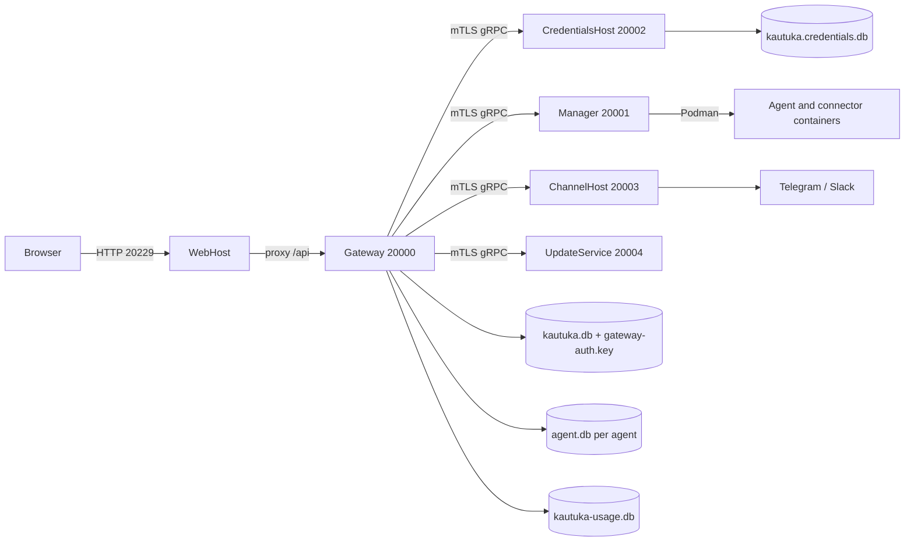

# System architecture

Kautuka is a local-first appliance composed of native .NET services, a React application, SQLite stores, and Podman-managed execution containers. Gateway is the public application API and orchestration boundary; privileged or secret-bearing responsibilities live in separate services.

## Runtime topology

The fixed ports and loopback client addresses come from `src/shared/Kautuka.Hosting/Hosting/KautukaHostNetworkPolicy.cs`. Production state roots come from `KautukaHostPathPolicy`; development uses the user-scoped runtime root.

## Service boundaries

- **Gateway** owns authentication, platform configuration, agents, providers, models, sessions, canonical runtime events, approvals, continuations, memory, usage staging, channel routing, and the public HTTP API.
- **CredentialsHost** owns encrypted credential persistence and credential authorization. Gateway calls it over mTLS gRPC.
- **Manager** owns durable desired workspace state, workspace path authority, Podman reconciliation, sandbox execution, and connector containers. Gateway currently performs attachment-file I/O inside Manager-resolved workspace paths.
- **ChannelHost** owns external messaging transports and their attachment state.
- **UpdateService** owns release discovery, staged update state, verification gates, apply/rollback orchestration via the root `apply-release` helper, and hosted catalog refresh.
- **WebHost** serves the built SPA and proxies `/api/**` to Gateway. It contains no domain state.
- **The Windows installer** prepares/imports the WSL appliance and waits for WebHost readiness.

Detailed RPC and lifecycle ownership is in the [service reference](../reference/services.md).

## A browser chat request

1. WebHost forwards the authenticated request to Gateway.
2. Gateway validates the user, selected agent, and session ownership.
3. Gateway creates or loads the per-agent session and starts a durable run.
4. Gateway's agent execution pipeline wraps provider/MAF output and emits canonical runtime events. Gateway commits each event and its delivery outbox before exposing it.
5. Gateway projects the canonical root stream to Narad. The workspace reduces authority events with `@devkrity/narad` and renders with `@devkrity/narad-react`.
6. Tools execute either in Gateway-owned tool adapters, a Manager-controlled sandbox/connector, or a child agent invocation.
7. An approval request creates a durable wait and pauses the root run. Resolution commits the decision but does not imply completion.
8. Same-tab Narad approval continues through the response stream. Out-of-band resolution attaches durable continuation work and emits revision invalidation; later pause/terminal boundaries may emit further revisions so open clients reconnect and replay canonical state.

The lifecycle details and pause boundaries are in the [execution model](execution.md).

## Dependency direction

Shared projects contain contracts and cross-cutting primitives; they do not depend on deployable hosts. Gateway depends on generated clients for internal services. Internal services do not call Gateway domain code. Manager container mechanics are isolated in `Kautuka.Manager.RuntimeContainer` so the gRPC host remains a thin control plane.

Architecture tests under `src/tests/Kautuka.ContractTests` and focused integration tests enforce important dependency, Native AOT, persistence, and security boundaries.

## Startup behavior

Gateway activates and validates the mandatory shared database before mapping endpoints. Empty stores receive the current baseline; non-empty incompatible schemas fail rather than migrate through compatibility paths. Per-agent stores follow the same current-schema rule. The usage database is optional for startup and reports unavailable when activation fails.

Built-in MCP and Skill bootstraps are awaited hosted startup work and can delay readiness; MCP import/metadata refresh can trigger Manager materialization. Execution/outbox, approval continuation, channel approval, memory, usage, and desired-state recovery continue through background workers after startup.

Manager reloads its desired-state ledger and reconciles accepted work after restart. CredentialsHost initializes its isolated schema before serving. ChannelHost initializes its attachment database before accepting RPCs.

## Where to change code

| Change | Start here |
|---|---|
| Public API | `src/backend/Kautuka.Gateway/Endpoints` |
| Runtime execution | `src/backend/Kautuka.Gateway/Domain/Execution` |
| HITL continuation | `src/backend/Kautuka.Gateway/Domain/Hitl` |
| Auto-Pilot launch and pre-run HITL | `src/backend/Kautuka.Gateway/Domain/Autopilot` |
| Narad projection | `src/backend/Kautuka.Gateway/RuntimePlane` |
| SQLite authority | schema baselines plus `Infrastructure/Configuration` repositories |
| Sandbox/containers | `Kautuka.Manager.RuntimeContainer` |
| Credentials | `Kautuka.CredentialsHost` |
| Browser | `src/frontend/web/src` |
