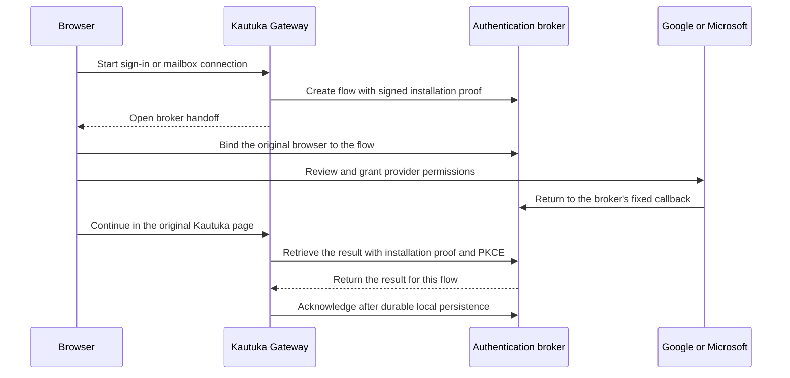

# Authentication and mail broker

Kautuka uses an authentication broker to connect a local installation to Google and Microsoft. The broker provides social sign-in and separate mailbox connections. An installation can use the hosted Kautuka broker or an operator's own compatible broker; it does not need a public callback address.

## Two distinct permissions

| Purpose | What the user authorizes | Where the OAuth application is configured |
| --- | --- | --- |
| Social sign-in | The provider identity used to sign in or link an account. | Login client ID and secret on the broker; the matching public client ID in Kautuka. |
| Mail connection | Mailbox access for the Google Mail or Microsoft 365 Mail connector. | Mail client ID and secret on the broker. |

These are separate applications and consent flows. Signing in with a provider does not itself connect a mailbox. Provider client IDs are public identifiers; client secrets belong on the broker. Google and Microsoft may require app verification or approval for the permissions requested.

## How a connection works

The browser and appliance can be on different machines, but the same browser must initiate and complete a flow. If the popup is blocked, the browser is changed, or the flow expires, start again. The broker does not send the provider result to an arbitrary callback chosen by the installation.

Kautuka creates a persistent installation key and registers its public key with the broker. Signed requests are bound to their method, destination and body, and protected against replay. Mail connections also have separate DPoP keys. Provider OAuth state and PKCE bind the authorization to the flow. The broker admits a verified mailbox before delivering its credential, and a connection generation prevents an in-flight refresh from reviving a disconnected connection.

The bound mail endpoints require a server-issued DPoP nonce scoped to the installation and mailbox key. The nonce is short-lived and reusable for concurrent operations; each proof identifier remains single-use. The Gateway retries only the broker's explicit pre-operation nonce challenge, with fresh proofs and the same operation body. A separate short-lived installation proof binds each request. This prevents using a proof generated before the applicable nonce was issued; it cannot protect against an attacker who currently controls both required keys. Existing nonce-less clients require a Gateway update before broker enforcement is deployed.

An installation key identifies a key, not an official build or a trustworthy operator. Someone controlling an installation can run the open-source code or register another installation. Users should grant mailbox access only to an installation and operator they trust. Broker-side disconnect prevents further brokered refresh for that connection; it cannot recall access tokens already issued by the provider or data already copied.

## Mail account limits and errors

Each installation can connect up to five distinct active Google mail accounts and five distinct active Microsoft mail accounts. Social sign-ins do not consume these limits. An account connected by more than one local user occupies one provider-account slot until all of its connections are removed. Shared or delegated mailbox access is not automatically counted as a separate account.

There is also a rolling limit on new accounts. Reconnecting an account already counted in the window does not use another allowance, and disconnecting does not erase the history. The broker's IP and per-location limits protect starts, polling, registration, validation and refresh; users on a shared network can encounter the same limit. Follow the retry guidance if the service returns a rate-limit error.

If a user declines consent or a flow expires, start a new sign-in. If the provider grants fewer required mail permissions, the connection is rejected and the user must grant the required permissions in a new flow. An ambiguous provider exchange is not blindly retried with the same code. If a disconnect cannot finish, Kautuka blocks local use and retains the information required to retry removal. Use the provider's permissions page to revoke an existing provider grant when needed.

## Using a self-hosted broker

Deploy and configure the [kautuka-auth service](https://github.com/devkrity/kautuka-auth), its Durable Objects, rate-limit bindings, and separate Google and Microsoft OAuth applications. Set `BROKER_ORIGIN` to the broker's HTTPS origin and register its exact `/callback` URL with each provider application. The broker operator must protect its client secrets and encryption keys and back up the mailbox pseudonym key with the broker state. Replacing that key without a coordinated migration changes account identities and breaks quota accounting; retain old encryption keys while their envelopes remain in use.

In Kautuka, open **Settings → Advanced → Authentication**. Enter the broker HTTPS origin and the public Google and Microsoft **social sign-in** client IDs that match its login applications. A blank social client ID disables that provider's social sign-in. Mail IDs and secrets are configured on the broker, not in these fields.

Before switching origins, keep an active administrator with a local password and disconnect existing mail connections. Save the new configuration and restart Kautuka; reconnect mail accounts afterward. Kautuka fences new mail sign-ins and installation-key rotation while the change is pending, and the pending change can be canceled from the same settings screen. Installation identities and saved mail credentials are scoped to their broker origin.

The loopback-only, administrator-authorized `/api/internal/broker/rotate-installation-key` endpoint rotates an installation key while retaining its identity and quotas. If the key is irrecoverably lost, the installation must establish a new identity and reconnect its accounts. A claimed installation ID or provider login alone cannot recover the old identity.

If an installation key is **stolen**, establishing a new identity does not disable the old broker identity, remove its connections, or revoke provider grants. The stolen installation key alone does not provide the separately stored mailbox keys and credentials, but an attacker with the installation key can rotate it and lock out the original installation. Contact the broker operator to request permanent suspension of the affected identity; it requires a separately configured operator credential and does not itself revoke provider grants or already-issued tokens. Disconnect affected mail accounts where possible and revoke the relevant Kautuka app grants through Google and Microsoft account permissions; reconnect only after the host is secure. Previously issued provider access tokens can remain valid until they expire or the provider revokes them. Avoid deleting the identity underneath active credentials; coordinate a replacement installation and reconnection instead.

An administrator on the local machine can retrieve the configured broker origin and existing public installation ID from the loopback-only `GET /api/internal/broker/installation-id` management endpoint, using the `AdminManagement` authorization policy. This endpoint does not create an identity and never returns the private key. Give the broker operator the origin and ID through a trusted channel; do not disclose credentials. The broker repository documents configuring the operator credential and invoking its suspension helper.

Once a mailbox operation detects suspension, Kautuka retains the saved credential and pending operation, marks that mailbox blocked, and stops presenting it as connected. Other mailboxes may still show their last known state until they contact the broker. A suspended identity cannot use the ordinary broker disconnect flow, and there is currently no in-place abandonment or reset workflow: work with the broker operator and revoke the provider grant before replacing the installation and reconnecting.

## Outages and deployment

When the broker is unavailable, new social sign-ins and mail connections cannot complete, and brokered mail credentials cannot be refreshed. Restore the broker and retry; for an ambiguous provider operation, start a new authorization when prompted. Existing Kautuka app sessions are not automatically signed out by the broker protocol change.

The independent security review and active remediation work are tracked in the [broker security follow-up plan](broker-security-follow-up-plan.md).

This protocol is a coordinated breaking change. Deploying the new broker retires the old hosted routes, so older Kautuka versions cannot start or renew hosted sign-ins. Plan the Gateway release and broker rollout together and tell users that existing mail connections must be reconnected. Before production rollout, provision and back up the mailbox pseudonym key and verify Durable Object migrations and rate-limit bindings. The release follow-ups for real-provider partial consent, lost responses and upgrade from the previous release are recorded in the [implementation plan](broker-connection-controls-plan.md).
