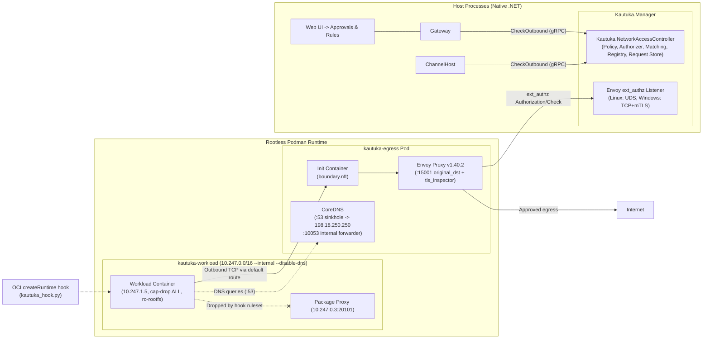

# Network Access Control (NAC) v7 Operations & User Guide

This guide describes the architecture, approval workflows, operational procedures, and troubleshooting diagnostics for **Kautuka Network Access Control (NAC) v7**.

---

## 1. Architecture Overview `[Partially implemented; not end-to-end verified]`

> **Status note:** This guide describes the target NAC v7 design. A rendered template or passing unit test does not prove a live Podman topology. The hook and policy components have local tests, and the launch path includes post-start checks for the ruleset hash, `no-new-privileges`, IPv6 disablement, Podman-resolved capability sets (including null empty sets), and mount sources restricted to desired workspace roots matching the workload's registry user and agent; verifier tests cover the same agent ID under a different user, a sibling agent, IPv6 disablement, and a captured rootless Podman inspect fragment. These tests have local Linux evidence but have not yet been confirmed by a CI run. Ephemeral `--rm -i` connector transports carry their verifier and cleanup state per call, use unique temporary container names, and verify/deregister through the real `CallToolAsync` path; the overlapping-call test passes on local Linux, but has not yet been confirmed by CI or a live Podman connector run. New connector and sandbox launches consult the startup gate and persisted brakes. Isolated connector launches keep user/agent identity labels while filtering workspace mounts; internal system connectors keep `deny-all` egress even when an agent invokes them with user context. Focused tests cover agent and probe argument construction and the missing-user failure. The boundary image lookup resolves the repository Dockerfile from the build output directory and fails with a direct diagnostic if the build fails. The full egress pod, stopping existing workloads under brake, and end-to-end acceptance still need real Podman/nft proof. Treat the sections below as design and operator intent until a capability is explicitly marked **Proven** by a real Podman/nft acceptance run.

`PodmanContainerTool` records and labels an agent identity only when its context scope is `agent`; a non-agent scope cannot inherit its scope ID as an agent ID. A Linux integration test covers rejection of a non-agent sandbox spec with no agent identity. Connector container fingerprints are derived at runtime from the resolved user/agent identity, execution context, connector image, and compatibility profile. The desired-state record does not infer an owner from the connector ID; runtime reconciliation supplies the launch identity when it compares a running connector.

Gateway writes explicit network privileges for user creation and role changes, and syncs every persisted user role to Manager during startup so existing admin records are backfilled. A failed Manager sync during a role change restores the previous Gateway role and returns `503`; a failed startup sync prevents Gateway startup. Reading an implicit admin default does not write the policy file. Linux integration tests cover startup backfill and disk persistence, promotion and demotion, and rejection of a demotion when Manager is unavailable. These are local test results, not CI or live-service evidence.

Registry rebuild processes each live container inspection independently, so malformed inspect output is logged and skipped without preventing later valid workloads from being registered. A local Linux integration test covers this failure isolation; it does not prove live egress topology initialization.

Kautuka NAC v7 enforces a strict **default-deny outbound network posture** for untrusted containerized workloads (Agent Sandboxes, MCP connector containers, and build-time tools), while providing unified application-layer enforcement and caller attribution for first-party host services (`Gateway`, `ChannelHost`).



### Key Architectural Pillars

1. **Centralized Static Egress Pod (`kautuka-egress`)**:
   - Workload containers run on an internal, isolated network (`kautuka-workload`, `10.247.0.0/16`) with default route `0.0.0.0/0 via 10.247.0.2` and DNS server `10.247.0.2:53`.
   - The egress pod is multi-homed between `kautuka-workload` and `kautuka-outside`, operating with `net.ipv4.ip_forward=0` and `net.ipv6.conf.all.disable_ipv6=1`.
   - Envoy `v1.40.2` acts as a transparent L4/L7 forward proxy listening on `0.0.0.0:15001`. It uses `original_dst` and `tls_inspector` listener filters to inspect TLS Server Name Indication (SNI) or destination IP addresses.
2. **Synthetic DNS Sinkhole**:
   - CoreDNS inside the egress pod listens on `10.247.0.2:53` for workload queries, returning a fixed synthetic IP (`198.18.250.250`) for all `A` queries and empty `NOERROR` for `AAAA` queries. DNS is never forwarded to external resolvers from the workload side.
   - Envoy resolves upstream domains via its internal loopback listener (`127.0.0.1:10053`), which forwards directly to host/system resolvers. This completely prevents workloads from sending forged SNIs to arbitrary IPs.
3. **OCI Runtime Hook (`scripts/nac/kautuka_hook.py`)**:
   - Podman triggers `kautuka_hook.py` at the `createRuntime` stage for every container.
   - Enforces atomic `table inet kautuka_workload` nftables rules in the container's network namespace:
     - Drops all IPv6 traffic (`ipv6_drop`).
     - Drops source-IP spoofed packets (`spoof_drop`).
     - Drops inter-container lateral traffic (`wl_net_drop`).
     - Drops link-local and cloud metadata addresses (`meta_drop` for `169.254.0.0/16` and Azure `168.63.129.16`).
     - Drops outbound UDP (`udp_drop`).
     - Permits outbound TCP to `10.247.0.2:15001` and DNS to `10.247.0.2:53`. The package proxy exception is disabled until Phase 6 is implemented.
   - Manager allocates a distinct workload IP before launch. Connector ownership comes from the workspace user and agent context; missing identity or address fails the start instead of falling back to a shared system identity or a fixed IP. Internal system connectors remain `deny-all` whether invoked without a user or through an agent. Systemwide per-user instances and their user-level grant attribution derive from catalogue scope, not `IsInternalSystemConnector`.
4. **Host Services Application-Layer Enforcement**:
   - `Gateway` and `ChannelHost` outbound HTTP and WebSocket clients fail closed (`FailClosedNetworkAccessChecker` / `checker_missing`) when constructed without an explicit `INetworkAccessChecker` or `NetworkAccessWebSocketChecker`. Non-ChannelHost callers must carry an explicit `NetworkAccessContext` user identity (never defaulting missing users to `"system"`), failing closed (`unknown_source`) when unattributed and enforcing per-user brakes across OIDC link, OAuth, AI provider discovery/probes, and catalog downloads. Denials surface directly into agent runs via Narad Protocol without opening approval cards for automated system seeds.
5. **Policy State Durability (`NetworkAccessPolicyStore`)**:
   - Approvals, revocations, user privileges, and emergency brake state flush synchronously (`SaveSync`) with directory fsync, while pending-request creation and retry attempt updates coalesce on a background writer ordered by a monotonic mutation sequence (`inMemoryMutationSeq`) with deterministic LRU eviction so older background snapshots cannot overwrite newer synchronous saves and transient write errors do not stall subsequent persistence.

---

## 2. User & Approval Workflows `[Implementation status varies; see status note above]`

### 2.1 Approval Cards `[Built]`
When an agent or connector attempts an outbound connection to an unapproved destination:
1. Envoy or Gateway blocks the connection and registers a pending access request in `NetworkAccessController`.
2. A single approval card appears in the **Network Approvals** section of the Kautuka Web UI.
3. The card clearly states:
   - **Who/What**: "{User}'s {Agent} ({Connector}) wants to reach {destination}:{port}".
   - **Attempts**: "First tried {time}, tried {n} times."
   - **Action Buttons**:
     - **Allow**: Grants an active rule scoped specifically to `(userId, agentId, destination, port)`. Agent-scoped rules apply to all tools and connectors executed by that agent; rule records do not store a connector ID.
     - **Keep blocked**: Rejects the request.
     - **Allow for all my agents, including new ones**: (Visible only if the request's owner possesses `canApproveOwn` and `canAllowAllAgents` privileges). Writes a `user`-scope rule `(userId, destination, port)` covering all existing and future agents owned by this user for this destination.
4. **Connector Probes (`v7-14`)**:
   - Probe containers (`io.kautuka.purpose=probe`) receive a temporary, **in-memory only** allow or block scoped strictly to `(probe container, user, connector, destination, port)`.
   - Probe approvals never write or modify persistent `user+agent`, `user+connector`, or `connector-system` rules and are cleared when the probe operation completes, independently of container deregistration. Subsequent runtime containers ask normally and write standard persistent rules.
   - User-owned connector probes go to the connector owner if they hold `canApproveOwn` (otherwise an administrator); systemwide connector probes always route exclusively to administrators.

### 2.2 User Privileges `[Built]`
Administrators manage per-user network privileges under User Settings:
- `canApproveOwn` (Default: **OFF** for standard users, **ON** for administrators):
  When enabled, the user can approve or deny network requests originating from their own agents. When disabled, requests escalate to administrators with a notice ("Waiting for an administrator to approve").
- `canAllowAllAgents` (Default: **OFF** for standard users, **ON** for administrators):
  Allows the user to create `user`-scope rules applying across all their agents. Unticking this privilege pauses all `user`-scope rules created by that user without deleting them; re-ticking restores them.
- **Role-Change & Card Synchronization**:
  Gateway persists initial admin and invited-user privileges synchronously into Manager (`SetUserPrivileges`) on account creation and role transitions (promotion enables both flags; demotion clears both flags and pauses existing `user`-scope rules). Approval cards and rule views read the stored Manager record rather than inferring flags from role alone.

### 2.3 Administrator Grants `[Built]`
- **Open Internet Grant (`any-public`)**:
  Administrators can grant open internet access to isolated containerized connectors (`scopeKind = user`, `destKind = any-public`, `port = 0`). This allows public internet egress while non-public IPv4 ranges (`NonPublicV4`) remain strictly enforced by kernel boundary rejection. Rule creation derives execution context and attribution server-side from Gateway's connector catalog and Manager's registry/desired-state/request records rather than trusting caller-supplied flags.
- **LAN Grants (`allowLan`)**:
  When LAN grants are enabled, connections to RFC1918 private subnets (`10.0.0.0/8`, `172.16.0.0/12`, `192.168.0.0/16`) route through Envoy's dedicated `dfp_lan` / `orig_dst_lan` clusters bound to `192.0.0.8`. The kernel boundary rule `lan_approved` permits this traffic while blocking access to `10.247.0.0/16` and metadata.

### 2.4 Emergency Brake `[Built]`
- **User Emergency Brake**: Immediately pauses network access for all containers owned by the user, stops running workload containers, and blocks new container creation.
- **System Emergency Brake (Admin Only)**: Halts all workload network egress across the entire instance and shuts down all running agent containers. Rules remain intact and are restored upon releasing the brake.

### 2.5 Image Compatibility Profiles `[Built]`
Third-party containerized MCP tools that cannot operate under hardened security defaults may be granted an admin compatibility profile keyed by image digest (`sha256:...`). The profile selectively relaxes:
- `writable-rootfs`: Permits a writable container filesystem.
- `root-user`: Permits execution as container UID 0.
- `file-ownership-caps`: Grants `CHOWN`, `DAC_OVERRIDE`, `FOWNER`, `SETUID`, `SETGID`, `FSETID`.
Network isolation, OCI hook firewall rules, and approval card requirements remain strictly enforced.

---

## 3. Operator Procedures & Diagnostics

### 3.1 Inspecting Hook State & Logs
The OCI runtime hook logs execution events to `$XDG_STATE_HOME/kautuka/nac/hook.log` (default: `~/.local/state/kautuka/nac/hook.log`).

Inspect the latest hook decisions:
```bash
tail -n 20 ~/.local/state/kautuka/nac/hook.log | jq .
```
Each log line records:
```json
{
  "ts_ns": 1731301200000000000,
  "duration_ms": 32.45,
  "id": "kautuka-mcp-user-agent-conn-hash",
  "pid": 48210,
  "hook_version": "7.0.0",
  "ips": ["10.247.1.15"],
  "netns_inode": 4026532890,
  "action": "allow",
  "reason": "workload_rules",
  "rules_sha256": "e3b0c44298fc1c149afbf4c8996fb92427ae41e4649b934ca495991b7852b855",
  "annotations": {
    "io.kautuka.role": "workload"
  }
}
```

### 3.2 Inspecting Network Namespace Ownership
The netns owners registry prevents container namespace hijacking:
```bash
cat ~/.local/state/kautuka/nac/netns-owners.json | jq .
```
Permissions must be strictly `0600` and owned by the running user. If this file is corrupted, the hook refuses container starts with `owners_unreadable`.

### 3.3 Verifying Firewall Rulesets

#### Boundary Table (Egress Pod)
Verify the boundary firewall inside the egress pod:
```bash
EGRESS_PID=$(podman pod inspect kautuka-egress -f '{{.InfraContainerID}}')
nsenter -t $EGRESS_PID -n nft list table ip kautuka_egress
```
Expected chains:
- `prerouting`: redirects TCP to port 15001.
- `forward`: policy drop.
- `input`: accepts port 15001 and port 53; drops all other incoming packets.
- `output`: contains `private_reject`, `wl_net_reject`, and optional `decision_endpoint` / `lan_approved`.

#### Workload Table (Agent / Connector NetNS)
Verify the workload firewall inside a running container:
```bash
CONTAINER_PID=$(podman inspect -f '{{.State.Pid}}' <container_id_or_name>)
nsenter -t $CONTAINER_PID -n nft list table inet kautuka_workload
```
Verify the following rule comments are present:
- `input_drop`
- `ipv6_drop`
- `spoof_drop` (verifying `ip saddr != <WORKLOAD_IP>`)
- `wl_net_drop`
- `meta_drop`
- `udp_drop`
- `final_drop`

### 3.4 Validating Static Templates `[Built]`

#### Envoy Static Configuration
Validate the rendered Envoy bootstrap configuration using the official Envoy container:
```bash
podman run --rm \
  -v /path/to/rendered/envoy.yaml:/etc/envoy/envoy.yaml:z \
  docker.io/envoyproxy/envoy:v1.40.2 \
  --mode validate -c /etc/envoy/envoy.yaml
```

#### Boundary NFTables Configuration
Validate the rendered boundary ruleset:
```bash
nft -c -f /path/to/rendered/boundary.nft
```

### 3.5 Live Container Acceptance `[Pending live Linux acceptance]`
End-to-end container acceptance tests (`U5-U7`, `C6-C7`, `C10`) execute against rootless Podman on Linux environments with `nf_tables` and `crun` enabled.

---

## 4. Troubleshooting Hook Refusal Reasons `[Built]`

When container startup fails with exit code 126 or 1, check the `reason` field in `hook.log`:

| Refusal Reason | Cause | Operator Action |
| :--- | :--- | :--- |
| `missing_pid` | Container state passed by OCI runtime contains no PID or PID <= 0. | Verify container runtime health (`crun` / `runc`). |
| `no_ip` | Container has no IPv4 interface or network namespace setup failed. | Check `podman network inspect kautuka-workload` and Netavark status. |
| `missing_allowlist` | `infra-allowlist.json` does not exist when starting a NAC container. | Restart `Kautuka.Manager` to regenerate the infrastructure allowlist. |
| `bad_allowlist_mode` | `infra-allowlist.json` permissions allow group or other access (must be 0600). | Fix permissions: `chmod 600 ~/.local/state/kautuka/nac/infra-allowlist.json`. |
| `bad_allowlist_owner` | `infra-allowlist.json` is not owned by the current user. | Fix ownership: `chown $USER ~/.local/state/kautuka/nac/infra-allowlist.json`. |
| `infra_ip_mismatch` | An allowlisted infra container has IP addresses differing from its registered allowlist entry. | Re-create the infra pod/container with the expected static IP. |
| `workload_off_network` | A container annotated with `io.kautuka.role=workload` is not attached to `10.247.0.0/16`. | Workload containers must only be attached to `kautuka-workload`. |
| `owners_unreadable` | `netns-owners.json` contains corrupt JSON, bad mode, or wrong owner. | Stop workloads, remove corrupt `netns-owners.json`, and restart Manager. |
| `reserved_range` | Container assigned an IP in reserved infra block `10.247.0.0/24`. | Check `WorkloadAddressAllocator`; workload IPs must start at `10.247.1.0`. |
| `bad_workload_ip` | Workload has multiple IPs, broadcast address (`.255`), or an IP outside `10.247.1.0-10.247.255.254`. | Verify IP allocation pool and Podman network subnet settings. |
| `shared_netns` | Container attempted to attach to a network namespace already owned by another active container. | Ensure workload containers use private namespaces and avoid `--net=container:`. |
| `apply_failed` | Applying `table inet kautuka_workload` via `nsenter` failed or ruleset verification failed. | Check kernel `nf_tables` module support and inspect `dmesg`. |

---

## 5. Outbound Redirect Policy (`v7-34`)
- `NetworkAccessCheckHandler` enforces `AllowAutoRedirect = false` on inner `SocketsHttpHandler` / `HttpClientHandler` instances and Gateway/ChannelHost `ConfigureHttpClientDefaults`.
- Any HTTP `3xx` `Location` target is also evaluated against `INetworkAccessChecker` and rejected with `NetworkAccessDeniedException` if unapproved rather than auto-followed silently.
- Chat tool-failure fallback lookup (`ChatToolNetworkAccessHelper`) queries Manager `ListRequests` as the current non-admin user (`IsAdmin = false`) and matches non-systemwide pending requests owned by the same `(userId, agentId)`.

## 6. AI Provider Endpoints (v7-37)
- There is no built-in localhost or Ollama exception. Gateway calls to a provider endpoint are denied until an admin grants a rule.
- At the **Test connection** step (Settings > Providers, and the first-run wizard), before the outbound test call, the admin is asked to allow the provider's address systemwide. Nothing is written on save, and Cancel sends no request and writes no rule.
- The grant is a `system`-scope rule (admin only; `PUT /api/network-access/rules`). Loopback addresses are accepted only in a `system` rule with an admin LAN grant. Focused local coverage includes `TestConnectionCreatesAdminApprovalBeforeSystemwideProviderRule_WithNegativeControl`; CI confirmation is pending.
