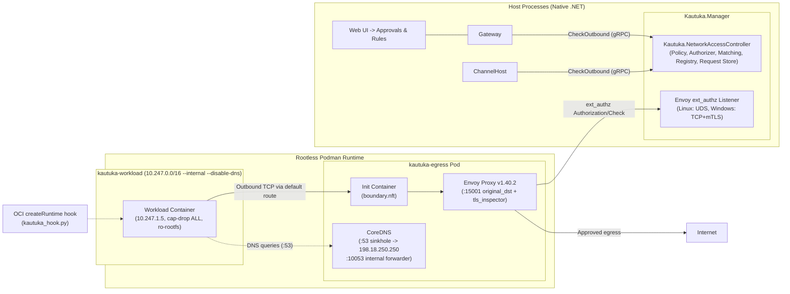

# Network Access Control (NAC) v7 Operations & User Guide

> **Current verification:** CI run [43517837642](https://github.com/devkrity/kautuka/actions/runs/43517837642) on source SHA `06a4333` passed `--prod-run`, C6, and the full integration suite. Its unedited seven-scenario artifact is committed at [nac-v7-prod-report-06a4333.json](nac-v7-prod-report-06a4333.json); the report records Envoy 1.40.2, Podman 5.7.0, an Azure Linux kernel, and 7/7 scenarios including LAN grant traffic reaching a routed fixture and the C6 tamper control. It applies to that source SHA and runner environment; it does not establish exhaustive platform coverage or a physical-host LAN run. The earlier WSL2 report [nac-v7-production-rootless-run.json](../verification/nac-v7-production-rootless-run.json) remains a separate local run matching source SHA `97b66ca`; that report does not establish CI results or physical-host LAN behavior. Follow-up run [43518533011](https://github.com/devkrity/kautuka/actions/runs/43518533011) passed the v7-19 Linux-only test guard change.

This guide describes the architecture, approval workflows, operational procedures, and troubleshooting diagnostics for **Kautuka Network Access Control (NAC) v7**.

---

## 1. Architecture Overview `[Partially implemented; not end-to-end verified]`

### Windows native development path

On Windows, Manager configures the development Podman Machine with the host decision endpoint and a dedicated Envoy client certificate bundle, then exposes the Envoy authorization listener over TCP with mTLS. The egress pod is recreated on Manager startup so its host mapping and certificate mounts stay current; its infra allowlist and boundary rules are copied into the Podman Machine before verification. Linux continues to use the rootless Unix socket path. Windows-specific setup is guarded by the Windows platform check, and launcher readiness follows the effective `Kautuka__Transport` setting (TCP when selected, otherwise the configured socket). This path has focused argument and mocked Podman Machine tests; live Windows Podman Machine end-to-end verification is still needed. The NAC `hooks_dir` drop-in uses containers/common array append mode to preserve earlier custom hook directories. Append mode also applies to later fragments, so later `hooks_dir` arrays append instead of replacing the accumulated list; placing the NAC drop-in late in sort order reduces but does not eliminate that interaction.

On Linux, the development launcher stages the repository OCI hook, its adjacent nft ruleset template, and a uniquely named hook configuration in a private per-run directory. It passes a `containers.conf` override to the Manager process only; the override appends the temporary hook directory to the existing Podman hook directories, leaving unrelated hooks configured there active. The launcher removes the staged files after Manager's process group has stopped. This development path has a fail-first canary check for a checkout with no installed NAC hook and rejects an inherited `CONTAINERS_CONF_OVERRIDE` rather than replacing it. It does not detect or reconcile another installed Kautuka NAC hook: if one is also discovered by Podman, both hooks may run, and coexistence across different hook versions or state locations has not been verified. Use the isolated development setup without an installed Kautuka hook for this validation path. Connector-supplied host environment override handling is a separate, unresolved issue, so this launcher setup does not establish that every connector launch is protected by the development hook override.

> **Status note:** This guide describes the target NAC v7 design. A rendered template or passing unit test does not prove a live Podman topology. The hook and policy components have local tests, and the launch path includes post-start checks for the ruleset hash, `no-new-privileges`, IPv6 disablement, Podman-resolved capability sets (including null empty sets), and mount sources restricted to desired workspace roots matching the workload's registry user and agent; verifier tests cover the same agent ID under a different user, a sibling agent, IPv6 disablement, and a captured rootless Podman inspect fragment. The verifier reads `net.ipv6.conf.all.disable_ipv6` from the workload's network namespace: on Linux through rootless `podman unshare nsenter`, and on Windows or macOS through `podman machine ssh` into the Podman VM. Podman 5.8.9 omits `HostConfig.Sysctls` from inspect, so the namespace value is authoritative. The production rootless Podman and Envoy report records seven scenarios: internal-parser deny-all, public-address rebind filtering, LAN approval and fixture access, sandbox approval and rule persistence, reconcile deregistration, verifier tamper detection, and DNS upstream enforcement. Each scenario's negative control produced its expected result. The report matches the production-acceptance artifact uploaded by CI run 43517837642; one successful run does not establish exhaustive platform coverage. The canary now requires a successful hook record for its own container ID and workload IP with a canonical hash matching the expected rendered workload ruleset; rendered boundary, Envoy, and CoreDNS configuration files are published by atomic replacement. Boundary nft output uses LF line endings so nft can parse it when the manager runs on Windows. On Linux, startup applies the generated boundary ruleset with the host nft binary in a disposable network namespace created through rootless `podman unshare`, hashes the native nft JSON, and compares it with both live boundary tables before opening the startup gate; reconcile compares live tables with that startup hash and closes the gate if they change. Reconcile also closes the gate if the persisted `boundary.nft` source no longer matches the rendered source hash captured at startup. Startup and reconcile also require a successful exit code from the boundary init container, not only an exited state. Existing egress pods are checked for their recorded workload/outside addresses and forwarding sysctls before startup trusts them. The Envoy and CoreDNS create arguments use their pinned images' non-root defaults; tests ensure no root override is supplied. Startup and reconcile now reject a degraded or incomplete egress pod and keep the NAC launch gate closed. These checks have local Linux tests; only the scenarios listed in the production report are confirmed against live Podman so far. The other verifier tests and overlapping ephemeral-call test passed in the CI integration suite; they remain test-level evidence rather than live Podman connector runs. New connector and sandbox launches consult the startup gate and persisted brakes. Connector reconciliation checks the owning user's brake before a temporary image build or stale-container replacement; `V7_20_ReconcileLaunchChecksBrakeBeforeRecreate_WithNegativeControl` passes locally, and `V7_20_ReconcileHonorsBrakeBeforeConnectorImageBuild` checks the guard placement. Both passed CI run 43517837642. Connector, sandbox, and package-builder specs now carry the current persisted system/user brake state instead of hardcoding `IsBraked=false`; the Fedora suite passed 2,239 tests with 5 skips locally and passed CI run 43517837642; emergency-brake activation still lacks a live acceptance run. If an emergency brake cannot stop or kill a workload, the registry retains its identity so authorization can still fail closed; this path has a local test but still needs live Podman proof. Isolated connector launches keep user/agent identity labels while filtering workspace mounts; internal system connectors keep `deny-all` egress even when an agent invokes them with user context. Focused tests cover agent and probe argument construction and the missing-user failure. The boundary image lookup resolves the repository Dockerfile from the build output directory and fails with a direct diagnostic if the build fails. The SHA-matched local report at `docs/verification/nac-v7-production-rootless-run.json` records E-rebind, E-parser, LAN grants, and a live internal connector launch through `CallToolAsync`. Emergency-brake behavior still needs production evidence. Treat the sections below as design and operator intent until a capability is explicitly marked **Proven** by a real Podman/nft acceptance run.

Sandbox and agent-file connector mounts are checked against the configured workspace base root from Manager desired state. Mount paths outside that root and paths traversing a symbolic link or reparse point are rejected before Podman arguments are rendered. Linux integration tests cover an escaping symlink and both production builders rejecting a workspace path outside the configured root; this remains unit-level evidence, not a live Podman mount test.

Agent sandboxes keep the hardened default UID `65532`; Manager mounts `/home/node` as tmpfs so that UID can traverse the home directory and create connector install paths such as `/home/node/.kautuka/connectors`. A real local Podman check confirmed the prior nested `/home/node/.kautuka` tmpfs was inaccessible to UID `65532` and the home-level tmpfs worked.

The Linux rootless Envoy authorization socket uses Envoy's pinned non-root image user and Podman's `keep-groups` option. The Manager creates the admin socket directory with group write and execute permissions; no dedicated service group is provisioned. CoreDNS's internal forwarder uses the resolver configured by Podman inside the egress pod; the boundary permits DNS only to the configured resolver addresses. Podman assigns the workload network's automatic and explicit default routes metric 1000 and the outside network's default route metric 100, so the egress pod sends external traffic through the outside gateway while workloads still route through the egress pod. Startup checks both network metrics and rejects drift. Focused Linux tests cover these settings. The production rootless report records the live route table and passing Envoy approval/rule, E-rebind, E-parser, and LAN-grant scenarios.

`PodmanContainerTool` records and labels an agent identity only when its context scope is `agent`; a non-agent scope cannot inherit its scope ID as an agent ID. Sandboxes without both a user and agent identity use `deny-all` egress and no attribution. Registry rebuild preserves explicitly restricted userless sandboxes, while rejecting userless normal-egress workloads. The post-start mount verifier matches the desired workspace by both agent and user, including a missing user. Focused tests cover sandbox identity and registry rebuild using generated labels and a fake Podman runner; they do not prove live Podman restart behavior. Connector container fingerprints are derived at runtime from the resolved user/agent identity, execution context, connector image, and compatibility profile. The desired-state record does not infer an owner from the connector ID. A Linux integration test verifies that reconciliation inspects and preserves the generated IsolatedWithAgentFiles container name for its desired user and agent, using the same fingerprint calculation as launch. This proves the reconciliation identity path with a fake Podman runner; it does not prove live Podman connector reconciliation.

Production Manager startup and `--prod-run` share the `InitializeProductionAsync` entry point. It enables the boundary's `lan_approved` rule so approved LAN connections routed through Envoy can pass the kernel boundary. The boundary init container assigns the LAN source address to the interface carrying the outside pod IP, rather than assuming an interface name. Integration tests check the hosted startup rendering and acceptance wiring; the recorded rootless Podman acceptance report separately proves a LAN approval reaches its fixture.

Gateway writes explicit network privileges for user creation and role changes. Startup adds role defaults only when a user has no saved privilege record; it preserves saved choices and records any backfill as the `system` actor. A failed Manager sync during a role change restores the previous Gateway role and returns `503`; a failed startup lookup or backfill prevents Gateway startup. Reading an implicit admin default does not write the policy file. Linux integration tests cover reopened-store startup behavior, backfill audit attribution, promotion and demotion, and rejection of a demotion when Manager is unavailable. These are local test results, not CI or live-service evidence.

When a connector's MCP process exits with a generic shutdown error, Manager appends up to the last 100 lines of that container's Podman logs, capped at 8 Ki characters. A Linux integration test exercises this fallback with a fake Podman runner; live Podman diagnostics have not been verified.

Registry rebuild processes each live container inspection independently, so malformed inspect output is logged and skipped without preventing later valid workloads from being registered. A local Linux integration test covers this failure isolation; it does not prove live egress topology initialization.

The U8 Envoy LAN address-filter test compares against a literal expected CIDR list, and the default egress boundary ruleset has a static golden. The workload nft text golden and embedded JSON template share literal rule-comment and key-address checks. Local Linux mutation runs caught an incorrect LAN exclusion, a missing terminal drop, and an incorrect Envoy listener port. These are renderer tests; they do not prove that a live Podman topology applied the ruleset.

Kautuka NAC v7 enforces a strict **default-deny outbound network posture** for untrusted containerized workloads (Agent Sandboxes, MCP connector containers, and build-time tools), while providing unified application-layer enforcement and caller attribution for first-party host services (`Gateway`, `ChannelHost`).



The package proxy shown in earlier NAC v7 diagrams is not deployed. Package-manager access through a proxy remains a Phase 6 design item; the current workload hook blocks that path.

### Key Architectural Pillars

1. **Centralized Static Egress Pod (`kautuka-egress`)**:
   - Workload containers run on an internal, isolated network (`kautuka-workload`, `10.247.0.0/16`) with default route `0.0.0.0/0 via 10.247.0.2` and DNS server `10.247.0.2:53`.
   - The egress pod is multi-homed between `kautuka-workload` and `kautuka-outside`, operating with `net.ipv4.ip_forward=0` and `net.ipv6.conf.all.disable_ipv6=1`.
   - Envoy `v1.40.2` acts as a transparent L4/L7 forward proxy listening on `0.0.0.0:15001`. It uses `original_dst` and `tls_inspector` listener filters to inspect TLS Server Name Indication (SNI) or destination IP addresses.
2. **Synthetic DNS Sinkhole**:
   - CoreDNS inside the egress pod listens on `10.247.0.2:53` for workload queries, returning a fixed synthetic IP (`198.18.250.250`) for all `A` queries and empty `NOERROR` for `AAAA` queries. DNS is never forwarded to external resolvers from the workload side.
   - Envoy resolves upstream domains via its internal loopback listener (`127.0.0.1:10053`), which forwards directly to host/system resolvers. This completely prevents workloads from sending forged SNIs to arbitrary IPs.
3. **OCI Runtime Hook (`scripts/nac/kautuka_hook.py`)**:
   - Podman triggers `kautuka_hook.py` at the `createRuntime` stage for every container.
   - The Linux installer requires the packaged hook payload and fails with a direct error if it is missing; the hook is installed executable at the path configured for rootless Podman.
   - Enforces atomic `table inet kautuka_workload` nftables rules in the container's network namespace:
     - Drops all IPv6 traffic (`ipv6_drop`).
     - Drops source-IP spoofed packets (`spoof_drop`).
     - Drops inter-container lateral traffic (`wl_net_drop`).
     - Drops link-local and cloud metadata addresses (`meta_drop` for `169.254.0.0/16` and Azure `168.63.129.16`).
     - Drops outbound UDP (`udp_drop`).
     - Permits outbound TCP to `10.247.0.2:15001` and DNS to `10.247.0.2:53`. The package proxy exception is disabled until Phase 6 is implemented.
   - Manager allocates a distinct workload IP before launch. Connector ownership comes from the workspace user and agent context; missing identity or address fails the start instead of falling back to a shared system identity or a fixed IP. Internal system connectors remain `deny-all` whether invoked without a user or through an agent. Systemwide per-user instances and their user-level grant attribution derive from catalogue scope, not `IsInternalSystemConnector`.
4. **Host Services Application-Layer Enforcement**:
   - `Gateway` and `ChannelHost` outbound HTTP and WebSocket clients fail closed (`FailClosedNetworkAccessChecker` / `checker_missing`) when constructed without an explicit `INetworkAccessChecker` or `NetworkAccessWebSocketChecker`. Non-ChannelHost callers must carry an explicit `NetworkAccessContext` user identity (never defaulting missing users to `"system"`), failing closed (`unknown_source`) when unattributed and enforcing per-user brakes across OIDC link, OAuth, AI provider discovery/probes, and catalog downloads. Denials surface directly into agent runs via Narad Protocol without opening approval cards for automated system seeds.
5. **Policy State Durability (`NetworkAccessPolicyStore`)**:
   - Approvals, revocations, user privileges, and emergency brake state flush synchronously (`SaveSync`) with directory fsync, while pending-request creation and retry attempt updates coalesce on a background writer ordered by a monotonic mutation sequence (`inMemoryMutationSeq`) with deterministic LRU eviction so older background snapshots cannot overwrite newer synchronous saves. Failed synchronous writes leave the previous in-memory state active and return the persistence error. Background write failures are logged and retried with exponential backoff.

---

## 2. User & Approval Workflows `[Implementation status varies; see status note above]`

### 2.1 Approval Cards
When an agent or connector attempts an outbound connection to an unapproved destination:
1. Envoy or Gateway blocks the connection and registers a pending access request in `NetworkAccessController`.
2. A single approval card appears in the **Network Approvals** section of the Kautuka Web UI.
3. The card clearly states:
   - **Who/What**: "{User}'s {Agent} ({Connector}) wants to reach {destination}:{port}".
   - **Attempts**: "First tried {time}, tried {n} times."
   - **Action Buttons**:
     - **Allow**: Grants an active rule scoped specifically to `(userId, agentId, destination, port)`. Agent-scoped rules apply to all tools and connectors executed by that agent; rule records do not store a connector ID.
     - **Keep blocked**: Rejects the request.
     - **Allow for all my agents, including new ones**: (Visible only if the request's owner possesses `canApproveOwn` and `canAllowAllAgents` privileges). Writes a `user`-scope rule `(userId, destination, port)` covering all existing and future agents owned by this user for this destination.
4. **Connector Probes (`v7-14`)**:
   - Probe containers (`io.kautuka.purpose=probe`) receive a temporary, **in-memory only** allow or block scoped strictly to `(probe container, user, connector, destination, port)`.
   - Probe approvals never write or modify persistent `user+agent`, `user+connector`, or `connector-system` rules and are cleared when the probe operation completes, independently of container deregistration. Subsequent runtime containers ask normally and write standard persistent rules.
   - User-owned connector probes go to the connector owner if they hold `canApproveOwn` (otherwise an administrator); systemwide connector probes always route exclusively to administrators.
   - A probe container can have at most 64 temporary approval cards. Further distinct destinations are denied without creating a card. Persisted legacy requests marked as probes cannot be approved into permanent rules.

### 2.2 User Privileges
Administrators manage per-user network privileges under User Settings:
- `canApproveOwn` (Default: **OFF** for standard users, **ON** for administrators):
  When enabled, the user can approve or deny network requests originating from their own agents. When disabled, requests escalate to administrators with a notice ("Waiting for an administrator to approve").
- `canAllowAllAgents` (Default: **OFF** for standard users, **ON** for administrators):
  Allows the user to create `user`-scope rules applying across all their agents. Unticking this privilege pauses all `user`-scope rules created by that user without deleting them; re-ticking restores them.
- **Role-Change & Card Synchronization**:
  Gateway persists initial admin and invited-user privileges synchronously into Manager (`SetUserPrivileges`) on account creation and role transitions (promotion enables both flags; demotion clears both flags and pauses existing `user`-scope rules). Approval cards and rule views read the stored Manager record rather than inferring flags from role alone.

### 2.3 Administrator Grants
- **Open Internet Grant (`any-public`)**:
  Administrators can grant open internet access to isolated containerized connectors (`scopeKind = user`, `destKind = any-public`, `port = 0`). This allows public internet egress while non-public IPv4 ranges (`NonPublicV4`) remain strictly enforced by kernel boundary rejection. Manager derives execution context and attribution from its workload registry, desired-state snapshot, and recorded request history; it does not trust caller-supplied context flags. If Manager cannot establish an enforceable context for a connector, it rejects an `any-public` rule with `scope_not_enforceable`.
- **LAN Grants (`allowLan`)**:
  When LAN grants are enabled, connections to RFC1918 private subnets (`10.0.0.0/8`, `172.16.0.0/12`, `192.168.0.0/16`) route through Envoy's dedicated `dfp_lan` / `orig_dst_lan` clusters bound to the egress pod's routable outside address (`10.248.0.3`). The boundary init container assigns this address to the outside interface, Envoy and CoreDNS's infrastructure allowlist entries include it, and the kernel boundary rule `lan_approved` permits traffic from it while blocking access to `10.247.0.0/16` and metadata. A production rootless Podman and Envoy run is recorded in `../verification/nac-v7-production-rootless-run.json`: seven scenarios passed, including an approved request reaching a LAN fixture, with a negative control for each scenario. The report records a local run; it does not establish CI results or exhaustive platform and policy coverage.

### 2.4 Emergency Brake
- **User Emergency Brake**: Immediately pauses network access for all containers owned by the user, stops running workload containers, and blocks new container creation.
- **System Emergency Brake (Admin Only)**: Halts all workload network egress across the entire instance and shuts down all running agent containers. Rules remain intact and are restored upon releasing the brake.

### 2.5 Image Compatibility Profiles
Third-party containerized MCP tools that cannot operate under hardened security defaults may be granted an admin compatibility profile keyed by image digest (`sha256:...`). The profile selectively relaxes:
- `writable-rootfs`: Permits a writable container filesystem.
- `root-user`: Permits execution as container UID 0.
- `file-ownership-caps`: Grants `CHOWN`, `DAC_OVERRIDE`, `FOWNER`, `SETUID`, `SETGID`, `FSETID`.
Network isolation, OCI hook firewall rules, and approval card requirements remain strictly enforced.

---

## 3. Operator Procedures & Diagnostics

### 3.1 Inspecting Hook State & Logs
The OCI runtime hook logs execution events to `$XDG_STATE_HOME/kautuka/nac/hook.log` (default: `~/.local/state/kautuka/nac/hook.log`).

When an ephemeral connector's MCP transport closes unexpectedly, Gateway includes up to the last 100 Podman log lines in the failure details when its container ID is available. Returned log text is capped at 8,192 characters.

Inspect the latest hook decisions:
```bash
tail -n 20 ~/.local/state/kautuka/nac/hook.log | jq .
```
Each log line records:
```json
{
  "ts_ns": 1731301200000000000,
  "duration_ms": 32.45,
  "id": "kautuka-mcp-user-agent-conn-hash",
  "pid": 48210,
  "hook_version": "7.0.0",
  "ips": ["10.247.1.15"],
  "netns_inode": 4026532890,
  "action": "allow",
  "reason": "workload_rules",
  "rules_sha256": "e3b0c44298fc1c149afbf4c8996fb92427ae41e4649b934ca495991b7852b855",
  "annotations": {
    "io.kautuka.role": "workload"
  }
}
```

### 3.2 Inspecting Network Namespace Ownership
The netns owners registry prevents container namespace hijacking:
```bash
cat ~/.local/state/kautuka/nac/netns-owners.json | jq .
```
Permissions must be strictly `0600` and owned by the running user. If this file is corrupted, the hook refuses container starts with `owners_unreadable`.

### 3.3 Verifying Firewall Rulesets

#### Boundary Table (Egress Pod)
Verify the boundary firewall inside the egress pod:
```bash
EGRESS_PID=$(podman pod inspect kautuka-egress -f '{{.InfraContainerID}}')
nsenter -t $EGRESS_PID -n nft list table ip kautuka_egress
```
Expected chains:
- `prerouting`: redirects TCP to port 15001.
- `forward`: policy drop.
- `input`: accepts port 15001 and port 53; drops all other incoming packets.
- `output`: contains `private_reject`, `wl_net_reject`, and optional `decision_endpoint` / `lan_approved`.

#### Workload Table (Agent / Connector NetNS)
Verify the workload firewall inside a running container:
```bash
CONTAINER_PID=$(podman inspect -f '{{.State.Pid}}' <container_id_or_name>)
nsenter -t $CONTAINER_PID -n nft list table inet kautuka_workload
```
Verify the following rule comments are present:
- `input_drop`
- `ipv6_drop`
- `spoof_drop` (verifying `ip saddr != <WORKLOAD_IP>`)
- `wl_net_drop`
- `meta_drop`
- `udp_drop`
- `final_drop`

### 3.4 Validating Rendered Configurations

These commands validate files that have already been rendered. The checked-in templates and renderer tests do not prove that a live Podman topology applied the files.

#### Envoy Static Configuration
Validate the rendered Envoy bootstrap configuration using the official Envoy container:
```bash
podman run --rm \
  -v /path/to/rendered/envoy.yaml:/etc/envoy/envoy.yaml:z \
  docker.io/envoyproxy/envoy:v1.40.2 \
  --mode validate -c /etc/envoy/envoy.yaml
```

#### Boundary NFTables Configuration
Validate the rendered boundary ruleset:
```bash
nft -c -f /path/to/rendered/boundary.nft
```

### 3.5 Live Container Acceptance `[Linux CI: production 7/7; full suite passed]`
The NAC acceptance workflow runs `--prod-run` against rootless Podman on Linux with `nf_tables` and `crun`; its production path includes the C6 post-start verifier and its tampering negative control. On commit `123200a`, CI run [43493361422](https://github.com/devkrity/kautuka/actions/runs/43493361422) passed topology startup, the canary, C6, and six of seven production scenarios, but `PROD_LAN_GRANT` did not receive the host fixture response after approval. The `lan_approved` counter incremented, and the observed Envoy route used the production outside-network gateway. Commit `4bbeb24` keeps the approval match on `10.248.0.3` and adds postrouting SNAT to Podman's assigned outside address `10.248.0.2`; CI run [43502037962](https://github.com/devkrity/kautuka/actions/runs/43502037962) showed that rootless Podman cannot connect directly to the runner's own physical LAN address (curl exit 7). Commit `424636b` moves the fixture to a separate routed network namespace connected by a veth pair on `192.168.248.0/24`. After fixing fixture teardown, CI run [43507042937](https://github.com/devkrity/kautuka/actions/runs/43507042937) passed the real production rootless Podman/Envoy acceptance (7/7, including `PROD_LAN_GRANT`) and the full integration suite. The workflow now retains the unedited production report as an artifact so it can be committed with its source SHA.

The non-Linux Podman Machine verifier command is covered by an integration test that forces the machine path and rejects a partial ruleset; that path has not been exercised against a live Podman Machine in CI.

The production acceptance runner stages Podman cleanup only after `podman info` confirms the private graphroot and runroot and reports rootless mode. Run `Kautuka.NetworkAccess.Acceptance -- --self-test-isolation-cleanup` to exercise the actual production proof with a fake Podman response; the test verifies that a failed isolation check causes no Podman cleanup calls.

---

## 4. Troubleshooting Hook Refusal Reasons `[Built]`

When container startup fails with exit code 126 or 1, check the `reason` field in `hook.log`:

| Refusal Reason | Cause | Operator Action |
| :--- | :--- | :--- |
| `missing_pid` | Container state passed by OCI runtime contains no PID or PID <= 0. | Verify container runtime health (`crun` / `runc`). |
| `no_ip` | Container has no IPv4 interface or network namespace setup failed. | Check `podman network inspect kautuka-workload` and Netavark status. |
| `missing_allowlist` | `infra-allowlist.json` does not exist when starting a NAC container. | Restart `Kautuka.Manager` to regenerate the infrastructure allowlist. |
| `bad_allowlist_mode` | `infra-allowlist.json` permissions allow group or other access (must be 0600). | Fix permissions: `chmod 600 ~/.local/state/kautuka/nac/infra-allowlist.json`. |
| `bad_allowlist_owner` | `infra-allowlist.json` is not owned by the current user. | Fix ownership: `chown $USER ~/.local/state/kautuka/nac/infra-allowlist.json`. |
| `infra_ip_mismatch` | An allowlisted infra container has IP addresses differing from its registered allowlist entry. | Re-create the infra pod/container with the expected static IP. |
| `workload_off_network` | A container annotated with `io.kautuka.role=workload` is not attached to `10.247.0.0/16`. | Workload containers must only be attached to `kautuka-workload`. |
| `owners_unreadable` | `netns-owners.json` contains corrupt JSON, bad mode, or wrong owner. | Stop workloads, remove corrupt `netns-owners.json`, and restart Manager. |
| `reserved_range` | Container assigned an IP in reserved infra block `10.247.0.0/24`. | Check `WorkloadAddressAllocator`; workload IPs must start at `10.247.1.0`. |
| `bad_workload_ip` | Workload has multiple IPs, broadcast address (`.255`), or an IP outside `10.247.1.0-10.247.255.254`. | Verify IP allocation pool and Podman network subnet settings. |
| `shared_netns` | Container attempted to attach to a network namespace already owned by another active container. | Ensure workload containers use private namespaces and avoid `--net=container:`. |
| `apply_failed` | Applying `table inet kautuka_workload` via `nsenter` failed or ruleset verification failed. | Check kernel `nf_tables` module support and inspect `dmesg`. |

---

## 5. Outbound Redirect Policy (`v7-34`)
- `NetworkAccessCheckHandler` enforces `AllowAutoRedirect = false` on inner `SocketsHttpHandler` / `HttpClientHandler` instances and Gateway/ChannelHost `ConfigureHttpClientDefaults`.
- Any HTTP `3xx` `Location` target is also evaluated against `INetworkAccessChecker` and rejected with `NetworkAccessDeniedException` if unapproved rather than auto-followed silently.
- Chat tool-failure fallback lookup (`ChatToolNetworkAccessHelper`) queries Manager `ListRequests` as the current non-admin user (`IsAdmin = false`) and matches non-systemwide pending requests owned by the same `(userId, agentId)`. When several requests match, it reports the one with the newest valid `LastSeenUtc`; Linux integration coverage checks both the selected destination and request ID, including a negative control with the ordering removed.

## 6. AI Provider Endpoints (v7-37)
- There is no built-in localhost or Ollama exception. Gateway calls to a provider endpoint are denied until an admin grants a rule.
- At the **Test connection** step (Settings > Providers, and the first-run wizard), before the outbound test call, the admin is asked to allow the provider's address systemwide. Nothing is written on save, and Cancel sends no request and writes no rule.
- The grant is a `system`-scope rule (admin only; `PUT /api/network-access/rules`). Loopback addresses are accepted only in a `system` rule with an admin LAN grant. The provider integration test passed in CI run 43517837642; the frontend approval/cancel test remains separately covered by the frontend suite.
- The provider test runs with a systemwide NAC identity so the pending request is attributed to the admin's provider test and can be approved through the system-scope rule flow. The focused test exercises `ProviderValidationService` and the provider's outbound NAC handler, then verifies the request exists before any rule is written.
