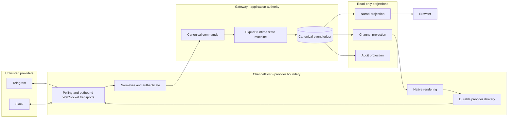
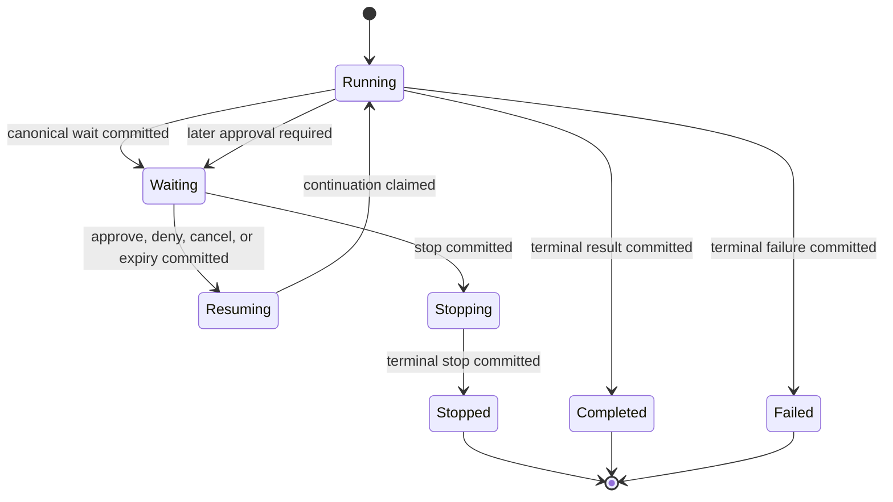
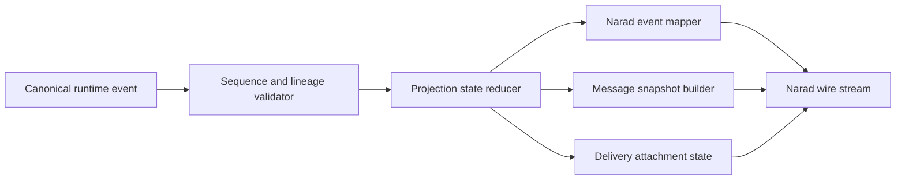
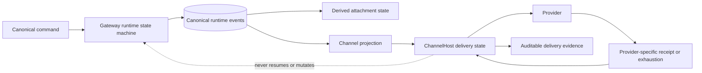

# Channel runtime hardening and acceptance automation backlog

**Status:** Active

**Owner:** Platform runtime, channel experience, and product security

**Activation condition:** Implementation starts only after the product owner reviews this backlog and explicitly approves each architecture decision gate in CRH-001 through CRH-006. Creating this backlog does not approve those decisions.

**Browser projection:** Narad (`/api/narad/v1`) is the workspace attach, mapping, and wire protocol.

**Architecture approval:** CRH-001 through CRH-006 were approved on 2026-07-19 with the constraints recorded in Proposed review disposition. The CRH-004 profile was subsequently approved: `Official` uses pinned provider endpoints; `Simulator` uses one explicitly configured loopback simulator address and is admitted only in Development or Test. Production rejects simulator mode at startup. Arbitrary provider URL overrides, TLS bypasses, and authentication bypasses are not supported.

**Wait-generation approval:** CRH-011 uses the existing identities without a new generation field. `WaitId` is the wait-generation identity and is fresh for every persisted pause. `ApprovalRequestId` is the immutable approval-generation identity; a direct approval wait binds `CorrelationId == ApprovalRequestId`, and at most one active wait may exist for that correlation. A later approval cycle requires a new approval request ID and a new wait ID. Reuse with divergent payload or lineage fails closed.

## Purpose

Turn the working polling-based Slack and Telegram baseline into a boring, explicit, restart-safe, standards-aligned system that is easy to audit. Remove tactical lifecycle seams rather than accumulating compatibility patches. Build a permanent Playwright acceptance system with standalone provider simulators so browser, channel, approval, AAAT, and canonical-event behavior can be verified repeatedly without asking a person to perform routine regression testing.

The baseline is commit `ce7fdfe6` (`feat: add secure polling channel gateway`). This backlog begins after that known-good point and does not reopen WhatsApp, permit inbound webhooks, or move runtime authority into ChannelHost.

## Product and engineering principles

- Kautuka Gateway owns authenticated users, tenants, agents, sessions, canonical runtime state, approvals, continuations, policy, and audit meaning.
- ChannelHost owns provider transport, provider protocol state, native rendering, durable provider ingress and outbound delivery, and provider capability degradation.
- Providers and provider identities are untrusted transport inputs, not Kautuka authority.
- Commands enter Kautuka once, canonical events are committed once, and every UI or channel observes the same committed truth.
- A projector may translate canonical events but must not infer, repair, or invent domain state.
- Channel callbacks may submit commands but must never resume an agent directly.
- Production code must not contain a hidden test execution path. Tests redirect standards-based provider endpoints to standalone simulators.
- Auditability is a release property: ownership, state transitions, dependencies, security boundaries, and failure recovery must be understandable from code and durable evidence.
- Code size alone is not the target. God classes, ambient correctness state, implicit coupling, duplicated projections, cross-module backdoors, and untraceable side effects are prohibited.

## Target boundary

## Known baseline seams to remove

These are accepted only as the committed working baseline. They are not the desired final architecture.

1. Narad attachment uses `CanonicalDeliveryAttachment` for cursor, snapshot/live handoff, and terminal attach (CRH-013/014). Open lifecycle reopen state remains reducer-owned on the projection session.
2. ~~Open Narad message lifecycle reattachment is tracked inside a partial `ProjectionSession`.~~ Projection collaborators are named types; open lifecycle state remains on the non-partial projection session per CRH-003.
3. Some continuation behavior is discovered from event shape and timing instead of an explicit canonical delivery/attachment state transition.
4. Browser and provider validation is split across focused tests and manual sessions rather than one repeatable cross-surface acceptance harness.
5. Current provider test doubles exercise adapters but do not yet behave as standalone protocol peers running across the real network boundary.
6. Live-provider verification still depends on manually prepared credentials and ad hoc execution evidence.

## Architecture decision gates

No decision in this section may be implemented merely because it is listed. Each gate requires a diagram-led review and explicit product-owner approval.

### CRH-001: Canonical run, wait, approval, and continuation state machine

Document the legal states and transitions for root runs, AAAT invocations, child runs, waits, approvals, cancellation, stop, failure, and terminal completion. Select which transitions require new explicit canonical events and which existing events remain authoritative.

Required decisions:

- whether delivery attachment and continuation readiness are explicit canonical events or derived read-model state;
- the exact owner of first-valid-resolution and exactly-once continuation claims;
- how root, child, invocation, wait, approval, delivery, and tool-call identifiers relate;
- the terminal meaning of Approve, Approve all for run, Deny, Cancel, Stop Run, expiry, process failure, and provider failure;
- which state is durable authority and which state is reconstructible projection; and
- compatibility and migration treatment for histories written before the selected event version.

Required diagram:

Cancel means cancel the pending tool and continue the run with a canonical cancelled tool result. It does not mean Stop Run. Stop Run is the only approval action that requests run termination. Acceptance: one written state-transition table covers browser and every channel; illegal transitions fail closed; no adapter or frontend component has independent transition semantics.

### CRH-002: Generalized run attachment and replay boundary

Choose one component responsible for attaching any delivery consumer to a canonical root at a durable sequence boundary. Replace route-specific terminal catch-up and timing inference with a general attach, snapshot, live-tail, deduplicate, and terminal-delivery contract.

Required decisions:

- attachment cursor and durable sequence semantics;
- atomic snapshot-to-live handoff;
- open text, reasoning, tool, activity, and interrupt lifecycle reattachment;
- reconnect after terminal completion;
- duplicate subscriber and concurrent attachment behavior;
- backpressure and slow-consumer behavior; and
- whether Narad delivery state is a focused collaborator, a projection checkpoint, or another explicitly approved model.

Acceptance: a consumer can attach before, during, or after any canonical event without a gap, duplicate effect, invalid Narad lifecycle, alternate projection, or inferred terminal patch.

### CRH-003: Projection ownership and auditability boundaries

Approve a small set of focused projection collaborators with one-way dependencies. Replace partial-class growth with named responsibilities where the existing type represents more than one independently testable concern.

Candidate decomposition for review:

Required decisions:

- whether the candidate split is accepted or revised;
- which component owns pending approval projection state;
- whether open lifecycle state belongs to the reducer or attachment component;
- permitted dependencies between canonical models, Narad models, transport writers, and frontend schemas; and
- file/type size ratchets and exemptions, if any.

Acceptance: an auditor can locate the owner of validation, state reduction, Narad mapping, snapshot generation, and delivery attachment without following partial classes or route-specific exceptions.

### CRH-004: Provider endpoint and simulator boundary

Approve configurable provider endpoints as a production-quality transport concern, not a test backdoor. Production defaults must remain pinned to official provider endpoints; non-production overrides must be explicit, observable, and prohibited by production admission policy unless separately authorized.

Required decisions:

- configuration shape for Telegram Bot API, Slack Web API and Socket Mode discovery;
- production policy for endpoint allowlists and TLS requirements;
- whether simulator trust uses a local development CA or another explicit test identity;
- how provider protocol versions are selected and recorded; and
- how live test environments are separated from customer registrations and credentials.

Acceptance: the same production worker binary runs against official providers and simulators; switching endpoints cannot weaken production TLS, authentication, ownership, or delegation policy.

### CRH-005: Acceptance scenario and evidence contract

Approve one provider-neutral scenario vocabulary shared by simulated CI runs and live-provider compatibility runs.

Required decisions:

- TypeScript/Playwright scenario DSL versus data-driven JSON/YAML plus TypeScript assertions;
- which observations are public UI/API assertions and which may read test-owned evidence endpoints;
- evidence retention, redaction, naming, and CI publication;
- deterministic clocks, identifiers, random seeds, and timeout budgets; and
- smoke, regression, full, soak, live-provider, and release-gate tags.

Acceptance: every result names commit, scenario, provider mode, seed, identities, canonical event range, browser trace, provider transcript, service logs, screenshots, and skipped cases without storing secrets or message bodies outside approved test evidence.

### CRH-006: Live-provider compatibility policy

Approve the split between deterministic simulation and official live development environments.

- Telegram: dedicated test environment for scheduled compatibility; optionally evaluate the official local Bot API server for transport compatibility, not deterministic simulation.
- Slack: isolated development workspace and Socket Mode application.

Required decisions:

- manual, scheduled, or release-triggered cadence;
- credential custody and rotation;
- cost/rate-limit budgets;
- destructive cleanup policy for test messages, channels, apps, and registrations;
- required provider matrix before release; and
- response to provider protocol drift.

Acceptance: normal CI requires no provider credentials; live compatibility failures cannot be silently treated as simulator success.

## Proposed review disposition

The following records the first external review of CRH-001 through CRH-006. It is decision input, not product-owner approval and not authority to begin implementation.

### Runtime truth versus delivery truth

Accept the recommendation that subscriber cursors, replay windows, snapshot boundaries, and consumer readiness remain derived attachment state. Accept that approval resolution and continuation claims are canonical Gateway runtime facts.

Do not place provider acknowledgements or best-effort exhaustion inside the canonical run state machine. They are transport outcomes with provider-specific meanings and must not influence whether a run, wait, approval, or continuation is authoritative. Preserve them durably as ChannelHost delivery facts and expose them through the audit model. If a canonical integration event is needed for cross-service observability, it must be a separate channel-delivery event family with no legal transition into runtime control.

The CRH-001 review must decide whether delivery intent requires a separate canonical integration event. It must not conflate delivery intent, provider receipt, consumer attachment, or runtime continuation.

### General attachment contract

Accept the proposed direction for CRH-002: Narad, channel delivery, audit, and future consumers attach through the same snapshot, cursor, live-tail, deduplication, and terminal-handoff abstraction. The abstraction consumes committed events and may persist consumer progress; it cannot decide runtime truth, manufacture terminal state, or write compensating runtime events.

### Projection responsibility split

Accept the proposed ownership rule for CRH-003 with one wording correction: the reducer knows the current truth of its projection, reconstructed from the canonical ledger; it is not an independent source of system truth. Pending waits and open runtime lifecycles belong to reducer state. Per-consumer observation and cursor state belong to attachment. Narad mapping remains a pure translation from approved projection inputs.

### Provider endpoint policy

Use one explicit transport profile. `Official` resolves pinned Telegram and Slack endpoints from product-owned constants. `Simulator` resolves the provider protocol surfaces beneath one configured loopback simulator address and is admitted only in Development or Test. Production rejects simulator mode during startup. Do not support arbitrary per-provider URL overrides or any setting that disables TLS, provider authentication, or Kautuka authorization. Add provider mode, resolved endpoint identity, protocol version, TLS policy, and configuration digest to sanitized execution evidence.

### Acceptance vocabulary

Do not introduce a JSON/YAML scenario language initially. Prefer typed, declarative TypeScript scenario records executed by Playwright, with reusable strongly typed steps and assertions. This keeps definitions readable while retaining compiler checks, refactoring support, one debugging model, and direct access to complex cross-surface assertions. Evidence output may be JSON. Reconsider an external data format only if a demonstrated non-code authoring need outweighs the cost of a second schema, validator, expression language, and versioning surface.

### Live-provider cadence

Accept simulator-only pull-request validation and mandatory live-provider validation for release candidates. Treat nightly live execution as an operational target subject to dedicated environments, credential custody, provider quotas, and noise measurement. A missed or unavailable live run is reported distinctly from pass or failure and can never be replaced by simulator success.

### Soak and concurrency thresholds

Do not adopt arbitrary scale numbers as architecture. Establish a declared supported resource envelope, capture a baseline, and then approve measurable thresholds. The review's 2-4 hour nightly, 12-24 hour release, 500 concurrent session, and 50 concurrent AAAT suggestions are useful starting probes, not completion criteria until the product owner accepts the supported envelope and the tests demonstrate stable measurement.

**Product-owner light envelope (2026-07-21):** prove the system accepts ~**200 canonical events/min** and **20 concurrent sessions/runs** under absolute correctness. Multi-hour soak and percentile SLOs remain deferred.

Correctness remains absolute at every scale: zero cross-owner leakage, duplicate terminal results, unresolved committed waits, invalid lifecycle transitions, or unexplained process/resource leaks.

### Product lifecycle decisions (2026-07-21)

- **CRH-013 / CRH-014:** authorized — replace tactical Narad attach/terminal seams with the approved generalized attachment owner.
- **Channel remove:** permanent retirement; suspend remains temporary. Public Gateway `remove` orchestrates ChannelHost soft-delete, CredentialsHost credential wipe, and no further traffic. Re-setup requires full Save & Connect on the deterministic attachment id.
- **CRH-032:** expand admitted surface (phase 1: command + file-on-message + stream-edit evidence). Inbound reactions / edit ingress remain a later phase.
- **M5 live providers:** deferred until the owner supplies isolated credentials or UI-exported config.

### Product boundary

Accept the conclusion that the listed runtime, simulator, evidence, and auditability work is within Kautuka's boundary. Explicitly exclude antivirus, DLP classification, general malware analysis, provider self-healing, and automatic ingestion of untrusted live payloads into simulator fixtures unless separately proposed and approved.

## P0 - canonical runtime hardening

### CRH-010: State-machine specification and executable transition tests

After CRH-001 approval, encode every legal and illegal transition as parameterized tests. Cover root runs, nested AAAT, sequential approvals, parallel independent runs, cancellation, stop, expiry, failure, retry, restart, and late resolution.

### CRH-011: Explicit continuation lineage

Ensure every approval and child wait maps durably to the exact root run, invocation, continuation run, tool call, child session, and current wait generation. Remove correctness dependence on ambient context, display names, latest-run lookup, timing, or provider identifiers.

### CRH-012: First-valid-resolution and exactly-one terminal result

Make competing browser/channel decisions transactional and idempotent. The first valid decision wins; duplicates return the committed result; conflicting late decisions cannot change outcome; every parent invocation receives exactly one terminal tool result.

### CRH-013: General attachment implementation

**Status (2026-07-21):** Implemented. `CanonicalDeliveryAttachment` owns consumer cursor, snapshot/reopen handoff, dedupe, and terminal attach. Connect-approval uses Narad attach; continuation attach shares the same delivery path with `rootRuntimeRunId`.

### CRH-014: Complete lifecycle reattachment

**Status (2026-07-21):** Implemented. Parameterized snapshot-attach proofs cover text, reasoning, activity, interrupt, nested, and terminal lifecycles. Playwright CRH-034/036 remain the cross-surface regression net.

### CRH-015: Restart-safe continuation recovery

Recover deterministically after Gateway, ChannelHost, browser, or host restart:

- before approval persistence;
- after approval persistence but before notification;
- while waiting;
- after resolution commit but before continuation claim;
- during continuation execution;
- after terminal result but before delivery completion; and
- during reconnect or snapshot/live handoff.

### CRH-016: Concurrency and lease hardening

Cover concurrent attachments to one root, concurrent approvals on different roots, the same child agent used by multiple parents, stale continuation leases, duplicate workers, slow subscribers, out-of-order provider events, and shutdown while work is leased.

### CRH-017: Canonical event migration and compatibility

If CRH-001 adds or changes events, define versioning, migration, old-history replay, rolling compatibility, downgrade rejection, integrity checks, and recovery from partial migration. Never rewrite historical meaning silently.

## P0 - standalone provider protocol simulators

### CRH-020: Simulator host and control contract

Create a standalone test process with isolated provider modules and a small authenticated control API. It must support deterministic scenario setup, inbound event injection, virtual time where required, captured outbound effects, fault scheduling, reset, and evidence export.

The simulator is not a clone of any provider. Each module implements only the protocol surface consumed by Kautuka and rejects unmodelled calls so coverage gaps remain visible.

### CRH-021: Telegram protocol façade

Implement the consumed Bot API subset, including `getMe`, durable `getUpdates` offsets and long-poll behavior, `sendMessage`, edits, actions, files used by Kautuka, provider errors, timeouts, duplicates, malformed updates, and rate limiting. Model the no-safe-idempotent-retry case for uncertain outbound effects.

### CRH-022: Slack protocol façade

Implement `apps.connections.open`, the Socket Mode WebSocket lifecycle, hello, envelopes, acknowledgements, disconnect/refresh, retry, message and interaction events, and the consumed Web API methods for messages, edits, files, reactions, and identity. Capture stable client message identity and simulate rate-limit headers and reconnects.

### CRH-023: Additional provider protocols

Provider expansion remains deferred until a product requirement defines its supported protocol, security boundaries, and acceptance criteria.

### CRH-024: Official fixture corpus and drift tracking

Maintain sanitized protocol fixtures sourced from official documentation and approved live captures. Record provider API version and fixture provenance. Add schema-shape and unknown-field tests without copying credentials, user content, or reusable provider identifiers.

### CRH-025: Fault and timing model

Support deterministic disconnects, latency, dropped acknowledgements, duplicate delivery, out-of-order delivery where the provider permits it, rate limits, transient and permanent failures, malformed frames, truncated responses, uncertain effects, clock skew, and process restart.

### CRH-026: Simulator conformance tests

Test each simulator against the documented provider subset so a broken simulator cannot produce false confidence. Run the same normalized ingress and semantic outbound fixtures against provider adapters and simulator transcripts.

### CRH-027: Simulator security and isolation

Bind simulators to loopback by default, use non-production credentials and trust material, authenticate the control API, prevent production activation, redact evidence, isolate parallel test runs, and remove all state at suite completion through a recoverable test-workspace lifecycle.

## P0 - Playwright cross-surface acceptance system

### CRH-030: Dedicated Playwright workspace and stack lifecycle

Create a standalone test workspace that starts the real Kautuka service graph, standalone provider simulator, and a real browser; waits on explicit readiness; records process identities; and shuts down only processes it owns. Reuse an existing running stack only through an explicit opt-in mode.

### CRH-031: Public setup and registration journeys

Automate sign-in and guided setup for Telegram and Slack, including manifests or setup artifacts, device/conversation identifiers, credential validation, activation, readiness, rotation, suspension, reconnect, removal, and actionable error guidance for an average user.

### CRH-032: Provider-neutral conversation scenarios

Drive inbound text, outbound responses, threading/replies, typing/progress, streaming or edits, chunk rollover, commands, reactions, files, unsupported-capability degradation, Unicode, provider limits, and terminal rendering through each simulator.

### CRH-033: Five-action HITL parity

For Chat, Approvals, Telegram, and Slack verify the exact action catalogue and semantics:

- Approve;
- Approve all for run;
- Deny;
- Cancel; and
- Stop Run.

Resolve every action from every permitted surface. Assert exact canonical decision, actor, source, trust-this-run scope, continuation behavior, terminal activity, provider update, browser responsiveness, and absence of duplicate resolution.

### CRH-034: Cross-surface synchronization

Create an approval in one surface, observe it in all others, resolve it in another surface, and require every open surface to converge without reload. Cover a browser attaching before request, while paused, during external resolution, during continuation, and after terminal completion.

### CRH-035: Nested AAAT lifecycle

Exercise one parent invocation with one and multiple child approvals, sequential nested tools, child cancellation, child stop, child failure, browser/channel mixed resolution, same-child-agent concurrency, restart at each boundary, and exactly one parent tool result.

### CRH-036: Snapshot, reconnect, and replay

Disconnect and reconnect the browser and provider transports at every lifecycle boundary. Assert valid Narad ordering for run, text, reasoning, tool, activity, interrupt, snapshot, terminal, and delivery events. Detect missing starts, duplicate deltas, stale cards, dead composers, and alternate projection output.

### CRH-037: Security-boundary acceptance

Run public-boundary negative scenarios for wrong workload certificate, wrong method role, missing/forged/expired delegation, replay, changed digest, owner substitution, registration substitution, conversation substitution, invalid callback, secret leakage, unsupported endpoint override, and production-mode simulator activation.

### CRH-038: Files and content safety

Cover upload/download authorization, provider file metadata, duplicate names, path-like names, content type, size limits, malformed Unicode, archive/decompression limits where applicable, expiry, wrong conversation, wrong registration, restart, and redacted errors.

### CRH-039: Evidence bundle and assertions

For every scenario capture:

- scenario ID, provider mode, seed, commit, and configuration digest;
- browser trace, screenshot at failure, console errors and warnings, and network failures;
- sanitized provider transcript and outbound effects;
- canonical event IDs and sequence range;
- approval, wait, invocation, and run identifiers;
- service warnings/errors and correlation IDs; and
- explicit pass, fail, skipped, or blocked status.

The harness must fail on unexpected browser console warnings/errors, service failures, invalid lifecycle transitions, unresolved waits, duplicate terminal results, secret-shaped evidence, or leaked owned processes.

### CRH-040: Existing checklist migration

Map every item in `docs/development/browser-verification.md` and `docs/development/channel-verification.md` to an automated scenario, an explicitly retained manual check, or a live-provider compatibility check. Do not call a run a Full browser pass while any required automated scenario is skipped.

## P1 - resilience, load, and soak validation

### CRH-050: Deterministic restart matrix

Automate process termination and restart at each durable boundary for Gateway, ChannelHost, provider simulator, and browser. Verify convergence from committed state without duplicate effects or manual repair.

### CRH-051: Network partition and reconnect matrix

Partition provider HTTP, provider WebSocket, Gateway-to-ChannelHost mTLS, browser SSE, and service dependencies independently. Verify bounded retry, lease recovery, backpressure, cursor correctness, and terminal reconciliation.

### CRH-052: Concurrency matrix

Run many registrations, owners, conversations, sessions, approvals, attachments, and AAAT invocations concurrently. Assert isolation, fairness, rate controls, ordering, and absence of cross-owner or cross-run state.

### CRH-053: Soak profiles

Define short pull-request soak, longer nightly soak, and release-candidate soak profiles. Include repeated reconnect, approval races, provider rate limits, process restarts, file traffic, and bounded storage growth. Record percentile latency, queue depth, retries, unresolved work, memory growth, and handle/process leaks.

### CRH-054: Failure triage and deterministic reproduction

Every randomized or soak failure must emit a seed and minimal replay command. Preserve the smallest failing provider transcript and canonical event range. A flaky retry without diagnosis is not an acceptable pass.

## P1 - auditability and modularity

### CRH-060: Component ownership map

Document each channel/runtime component, its authority, inputs, outputs, durable stores, side effects, security assumptions, failure modes, and prohibited responsibilities. Link each public contract and canonical event to one owner.

### CRH-061: Dependency-direction enforcement

Add architecture tests preventing provider adapters from depending on Gateway domain authority, projectors from performing mutations, frontend code from inferring runtime truth, transports from resolving approvals, and external consumers from accessing administrative or credential services.

### CRH-062: God-class and partial-class ratchets

Retain file-size checks but add conceptual-owner checks: partial declarations count together, constructor dependency counts are bounded, public method growth is ratcheted, and exceptions require a documented decision. Refactor responsibilities instead of increasing thresholds.

### CRH-063: Canonical event catalogue

Maintain a versioned catalogue containing producer, payload schema, authority meaning, legal predecessor/successor states, idempotency identity, privacy class, consumers, compatibility policy, and example sanitized event for every canonical runtime event.

### CRH-064: Security decision traceability

Map threat-model statements to authorization policies, implementation owners, negative tests, operational evidence, and residual risks. An auditor must be able to trace a privileged method from transport identity through delegation, resource authorization, durable mutation, effect, and audit record.

### CRH-065: Operational runbooks

Document certificate and signing-key rotation, provider credential rotation, registration suspension, replay denial, uncertain provider effect, stuck continuation, failed migration, provider outage, simulator/live-test failure, and evidence collection without exposing secrets.

### CRH-066: Test-code auditability

Keep scenario definitions declarative, helpers narrow, selectors user-facing, provider fixtures centralized, sleeps prohibited except inside bounded polling helpers, and assertion ownership explicit. Apply formatting, lint, dependency, duplication, and size ratchets to the acceptance code itself.

## P1 - official live-provider compatibility

### CRH-070: Telegram test-environment suite

Run the shared compatibility scenarios against Telegram's dedicated test environment with a separate test account and bot. Cover long polling, cursor advancement, inline actions, edits, files, rate-limit response, restart, and identity binding. Treat the official local Bot API server as an optional compatibility target, not a substitute for deterministic simulation.

### CRH-071: Slack development-workspace suite

Run the shared compatibility scenarios against an isolated Slack development workspace and Socket Mode app. Cover connection refresh, acknowledgements, message/action envelopes, edits, files, reactions, rate limits, restart, and workspace/user/channel isolation.

### CRH-072: Additional provider compatibility

Any future provider compatibility suite requires an isolated environment and a defined protocol matrix.

### CRH-073: Provider drift gate

Compare live transcripts with the sanitized fixture corpus. Classify additive, compatible, deprecated, and breaking drift. Block release for unreviewed breaking drift or security-relevant unknown behavior; do not automatically teach simulators from untrusted live payloads.

## Milestones

### M0: Architecture approved

- CRH-001 through CRH-006 reviewed with diagrams.
- Decisions recorded as ADR updates or new ADRs.
- No implementation begins before approval.

### M1: Canonical lifecycle boring

- CRH-010 through CRH-017 complete.
- Tactical attachment and partial lifecycle seams removed.
- Restart, concurrency, and exactly-one terminal-result tests pass.

### M2: Deterministic provider laboratory

- CRH-020 through CRH-027 complete.
- Telegram and Slack standalone simulators run without provider credentials.
- Real production workers pass the simulator conformance matrix.

### M3: Automated cross-surface acceptance

- CRH-030 through CRH-040 complete.
- Browser, Approvals, Telegram, and Slack share one scenario catalogue.
- The existing browser and channel verification documents map to executable evidence.

### M4: Resilience and auditability

- CRH-050 through CRH-066 complete.
- Restart, partition, concurrency, and soak profiles meet agreed thresholds.
- Architecture and auditability ratchets pass without exemptions introduced solely for this work.

### M5: Live compatibility and release gate

- CRH-070 through CRH-073 complete for all admitted providers.
- Full browser and channel passes are recorded with no unexplained warning, lifecycle failure, unresolved wait, duplicate effect, or skipped required scenario.

## Completion gate

Do not call this backlog complete until all of the following are true:

- the product owner has approved every architecture decision gate;
- one explicit canonical state model governs browser and channel behavior;
- no route-specific terminal catch-up, alternate projection, or adapter-owned continuation remains;
- every approval action has identical canonical semantics across all surfaces;
- provider simulators exercise the real production workers over process/network boundaries;
- routine validation requires no live credentials or manual user testing;
- live provider suites separately prove current external compatibility;
- restart, replay, race, concurrency, partition, and soak matrices pass;
- browser and service logs contain no unexplained warnings or errors;
- security tests prove denial without partial side effects or leaked secrets;
- architecture tests enforce dependency direction and conceptual owner size;
- every important state transition and privileged effect is traceable by an auditor; and
- `docs/development/browser-verification.md` and `docs/development/channel-verification.md` both record a Full pass with every exclusion explicitly resolved.

## Review questions

1. Is the CRH-001 state-machine boundary correct, or should delivery attachment remain purely derived state?
2. Do you approve replacing tactical attachment logic with the generalized CRH-002 component?
3. Is the CRH-003 proposed projection decomposition understandable and appropriately small?
4. Do you approve configurable provider endpoints with production allowlist enforcement?
5. Should the acceptance vocabulary be TypeScript-first, or data-driven with TypeScript assertions?
6. What cadence should the live Telegram and Slack suites use?
7. What measurable soak duration and concurrency target should define the first production-quality gate?
8. Are any listed scenarios outside the intended Kautuka product boundary?
