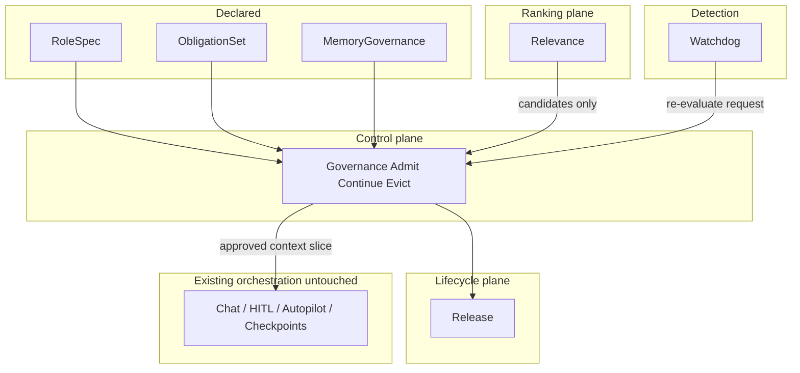

# Memory governance backlog

**Status:** Active

**Owner:** Product architecture

**Activation condition:** Product architecture selects a first persona RoleSpec/ObligationSet pair and approves Phase 1 hard-gate scope before any admit/continue/evict control-plane work lands in Gateway.

**Related Cursor plan:** `.cursor/plans/memory_governance_backlog_9d2f313c.plan.md` (mirror; this file is canonical in-repo)

## Outcome

Add institutional memory governance for Kautuka: declared policy → admit / continue / evict → relevance → watchdog → release. Extend existing memory and tool-policy seams without rewriting chat, HITL, autopilot, or checkpoint orchestration.

Kautuka is process-oriented: an agent is a persona of a real person. Memory serves role, obligation, and work continuity—not companion chat continuity.

## Design constraints (non-negotiable)

- **Enhance orchestration; do not absorb it.** HITL, checkpoints, autopilot run status, and MAF session state remain **process/run state**. Memory governance never owns resume/wait/approval waiters.
- **Model proposes; governance decides; platform enforces.** Admit / Continue / Evict are deterministic, policy-ID-logged decisions. The model never authorizes retention or activation.
- **Persona ≠ soft prompt only forever**, but Phase 1 does not replace [`BuildScopeContractContext`](../../src/backend/Kautuka.Gateway/Domain/Execution/ChatExecutionHelpers.cs) with LLM judgment—hard gates first.
- **Declared roots stay small:** `RoleSpec`, `ObligationSet`, `MemoryGovernance`. Nested fields for tone, retention, access—not six peer top-level products.
- **Continuation caveat:** resume may freeze [`EffectiveRunBehavior.MemoryContext`](../../src/backend/Kautuka.Gateway/Domain/Execution/EffectiveRunBehavior.cs). Later phases must define whether memory is refreshed on resume or stays frozen with the run (default: freeze for run integrity; refresh only on new user/admin turn).

## What already exists (build on these)

| Seam | Path | Use |
|---|---|---|
| Scope stub | [`IMemoryScopePolicy`](../../src/backend/Kautuka.Gateway/Domain/Memory/IMemoryScopePolicy.cs) / [`DefaultMemoryScopePolicy`](../../src/backend/Kautuka.Gateway/Domain/Memory/DefaultMemoryScopePolicy.cs) | Real multi-scope later |
| Assemble gate | [`ChatMemoryAssembler`](../../src/backend/Kautuka.Gateway/Domain/Memory/ChatMemoryAssembler.cs) | Admit-to-context |
| Persist gate | [`ChatGatewayService.Persistence.cs`](../../src/backend/Kautuka.Gateway/Domain/Execution/ChatGatewayService.Persistence.cs) | Admit-to-store |
| Settings knobs | [`MemorySettings`](../../src/backend/Kautuka.Gateway/Infrastructure/Configuration/MemorySettings.cs) | Wire unused `MaxInjectedFacts` |
| Tool policy pattern | [`ToolExecutionPolicyService`](../../src/backend/Kautuka.Gateway/Infrastructure/Agents/ToolExecutionPolicyService.cs) | Mirror decision shape for memory—do **not** route through HITL |
| Soft role | Persona + scope contract in [`AgentRuntimeFactory`](../../src/backend/Kautuka.Gateway/Infrastructure/Agents/AgentRuntimeFactory.cs) | Evolve into `RoleSpec` |
| Process state | Autopilot / checkpoints / HITL | Stay separate |

---

## Epic 0 — Foundations and contracts (docs-as-code + types)

**Goal:** Lock vocabulary so later PRs do not reinvent chat-memory.

0.1 **ADR: Institutional memory vs run state**
- Define: role / obligation / work memory / operational patterns / run state.
- Explicit non-goals: companion chat continuity as primary object; Hermes/Memori feature parity.

0.2 **Core decision types** (new small domain module under `Domain/Memory/Governance/`)
- `MemoryDecision` = `{ Verb: Admit|Continue|Evict, Outcome, PolicyIds[], ReasonCode, EvidenceRef? }`
- `FrameCandidate` / `MemoryCandidate` records (id, class, scope, proposed-by, scores).
- Decision log interface (append-only); first implementation = structured logs + optional runtime activity entries—not HITL events.

0.3 **Config shape (declared roots only)**
- Spec sketches for `RoleSpec`, `ObligationSet`, `MemoryGovernance` (JSON schema / records).
- Nest: interaction mode, retention, access, allowed memory classes.
- Do not ship full admin UI yet.

**Exit:** Types + ADR reviewed; no behavior change required.

---

## Epic 1 — Governance verbs on the existing pipeline (orchestration-safe)

**Goal:** Make legitimacy enforceable on today’s fact bag before new storage classes.

1.1 **Wire existing knobs**
- Use `MemorySettings.MaxInjectedFacts` (and token budget) in assembler/builder instead of hardcoded `40`.

1.2 **`IMemoryGovernanceService`** (deterministic)
- Methods: `EvaluatePersist`, `EvaluateInject`, `EvaluateEvict`.
- Inputs: candidate + `MemoryGovernance` defaults + agent session flags.
- Phase 1 rules: confidence thresholds, category allow/deny lists, max store size, max inject, optional TTL field on facts (nullable).
- Output: `MemoryDecision` with policy IDs.

1.3 **Hook persist path**
- In `ExtractAndStoreFactsAsync`: every fact passes `EvaluatePersist` before `UpsertAgentMemoryFacts`.
- Log admit/deny with policy id (extend existing `FactExtraction*` logs).

1.4 **Hook inject path**
- In `ChatMemoryAssembler.AssembleAsync`: rank first (existing), then `EvaluateInject` per candidate; drop denied.
- Do not change `AgentChatService` streaming or Autopilot entrypoints beyond consuming the already-assembled list.

1.5 **Minimal release**
- Background or on-read eviction for expired TTL / over-quota (oldest non-obligation facts first).
- Manual delete already exists—keep it; add policy-driven purge.

1.6 **Audit answers (admin-readable)**
- API or settings extension: list recent memory decisions for an agent (why admitted / denied / evicted).
- Prefer new lightweight endpoint; do not overload approval APIs.

**Exit:** Same chat/autopilot UX; every persist/inject is policy-gated and explainable. Orchestration paths unchanged.

---

## Epic 2 — Declared governance objects (admin-defined boundaries)

**Goal:** Move knobs from ambient `MemorySettings` + soft persona into inspectable agent-level declarations.

2.1 **`RoleSpec`**
- Evolve from persona profile + scope contract: responsibilities, allowed domains/tools categories, must-not (soft text initially, linked to hard tool policy where possible).
- `PROCESS_AGENT` (and similar) categories become first-class interaction/work mode, not just sampling defaults.

2.2 **`ObligationSet`**
- Standing must / must-not / require-approval mirrors of tool policy where applicable; memory may store *references* to obligations, not invent new approval runtime.
- Adaptation (tone) explicitly forbidden from mutating obligations.

2.3 **`MemoryGovernance`**
- Allowed memory classes (e.g. identity/obligation/work/operational—start as labels on `GatewayMemoryFact.Category` + class enum).
- Scope (agent / user / tenant—read path via real `IMemoryScopePolicy`).
- Retention TTLs per class; inject budgets per mode (chat vs autopilot source).
- Access rules (who can list/edit facts)—align with existing ownership patterns.

2.4 **Settings + UI (thin)**
- Agent settings: view/edit the three roots.
- Memories page: show class + governing policy id on facts.

**Exit:** Admins can answer “what may this persona store and for how long?” without reading prompts.

---

## Epic 3 — Process vs conversation asymmetry (enhance orchestration)

**Goal:** Same fabric; different legitimacy envelope by source/mode—without forking Autopilot off `StreamChatAsync`.

3.1 **Assembler profiles by `source`**
- `chat` / channel vs `autopilot` (and future job sources): tighter inject budget, narrower class allowlist for process runs.
- Autopilot keeps using [`AutopilotRunExecutionService`](../../src/backend/Kautuka.Gateway/Domain/Autopilot/AutopilotRunExecutionService.cs) → chat stream; only governance profile changes.

3.2 **Work memory vs run state**
- Document and enforce: checkpoints remain run state.
- Optional: promote *reusable* failure heuristics to operational memory **after** terminal run + governance Admit (never auto-copy full checkpoint JSON into memory).

3.3 **Frozen behavior vs live memory**
- Spec: on HITL continuation, keep frozen `MemoryContext` for that run; on new message, re-assemble under governance.
- Tests for “resume does not silently expand memory mid-approval.”

**Exit:** Process agents remember less, more precisely; chat continuity does not pollute scheduled work.

---

## Epic 4 — Relevance and compression inside the envelope

**Goal:** Learning only ranks within admitted space.

4.1 **Relevance as proposal only**
- Keep/improve embedding rank in assembler; output is ordered *candidates*, not authorization.
- Category / class boosts as policy-weighted signals, not free model preference.

4.2 **Session compaction under governance**
- [`SessionCompactionService`](../../src/backend/Kautuka.Gateway/Domain/Sessions/SessionCompactionService.cs): compaction summary stays session-scoped unless governance Admits a durable “work summary” class.
- Stop treating compaction as indistinguishable from durable identity facts (already a fake inject—label and gate it).

4.3 **Pattern extraction (operational memory)**
- Separate extractor path for reusable failures/playbooks (opt-in, high persist bar, short default TTL unless admin pins).
- Never learn new obligations from patterns.

**Exit:** Compression and ranking cannot expand the policy envelope.

---

## Epic 5 — Frame watchdog (detection only)

**Goal:** Detect stale framing; do not self-authorize eviction.

5.1 **`IFrameWatchdog`**
- Signals: task objective change, obligation conflict, tool/scope mismatch vs `RoleSpec`, repeated failure under same frame.
- Emits `ReevaluateRequested` with evidence refs—not Evict.

5.2 **Governance re-evaluation**
- On watchdog signal: Continue vs Evict via rules; optional escalate to human using **existing HITL** only when policy says require-approval for eviction of pinned work memory—not for ordinary inject denials.

5.3 **Orchestration integration (minimal)**
- Prefer mid-turn or post-tool hooks that already exist for activity/events; avoid new pause machinery unless obligation policy demands it.

**Exit:** Drift is detectable and auditable; enforcement remains governance/release.

---

## Epic 6 — Platform enforcement hard floor

**Goal:** Isolation, retention, safety independent of model agreement.

6.1 Tenant/user isolation tests for scope policy.
6.2 Mandatory purge jobs + deletion audit.
6.3 Safety filters on persist (secrets/PII patterns)—deny with policy id.
6.4 Admin query pack: why admitted / why evicted / which rule / who can see.

---

## Explicitly out of backlog (protect orchestration)

- Rewriting `AgentChatService` streaming, Narad protocol, or channel ingress for memory.
- Replacing HITL/checkpoints with memory decisions.
- Building a standalone Memori/Hermes-style external memory product.
- Letting the model edit `RoleSpec` / `ObligationSet`.
- Unifying run wait-state stores with `runtime_memory_facts`.

---

## Suggested delivery order (PRs)

1. Epic 0 types + ADR
2. Epic 1 governance service + persist/inject hooks + audit (highest leverage, lowest orchestration risk)
3. Epic 2 declared roots + thin settings
4. Epic 3 mode profiles + continuation freeze rules
5. Epic 4 ranking/compression discipline
6. Epic 5 watchdog
7. Epic 6 hard floor / compliance polish

## Success metrics

- Every injected/persisted fact has a decision record with policy ids.
- Autopilot inject budget/class allowlist stricter than chat by default.
- Zero changes to approval wait/checkpoint state machines required for Epics 0–3.
- Admin can explain admit/evict for a sample agent without reading model transcripts.
