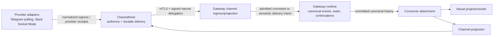

# Channel runtime ownership and audit map

This is the CRH-060 ownership map for the polling-only channel runtime. It is an audit index, not a second runtime design: code, protobuf contracts, schemas, and the named tests remain authoritative. See [service responsibilities](services.md), the [Narad authority event catalogue](runtime-events.md), and the [security model](../architecture/security.md).

## One-way authority flow

No arrow grants the receiver authority to make the sender's decisions. In particular, ChannelHost cannot resolve a Kautuka approval or resume a run, and a browser/channel projection cannot repair or invent runtime history.

## Component accountability

| Owner | Authority and durable stores | Inputs | Outputs / side effects | Security assumptions | Fail closed / failure handling | Explicitly prohibited | Public contract / canonical events |
|---|---|---|---|---|---|---|---|
| Gateway runtime | Run, wait, approval, continuation and invocation stores; canonical event ledger | Authenticated commands; committed recovery work | Execution; canonical mutations | Authenticated user/owner and authorized agent/thread | Invalid lineage, wait, or transition is rejected; recovery uses durable leases | Provider protocols, delivery receipts, consumer cursors | `/api/narad/v1`; produces Narad authority events |
| Runtime event publisher | Event and outbox transaction; root sequence | Validated runtime fact | Committed event, outbox wake-up | Store transaction is authority | Pending/expired lease is retried; invalid event is never published | Changing event meaning or filling history gaps | Internal publisher; publishes catalogue events |
| Runtime reducer | Read-only canonical projection | Ordered committed events | Reconstructible state | Input is canonical and root-bound | Rejects illegal ordering/lifecycle | Mutating stores, resolving approval, continuation | Internal projection; consumes all canonical events |
| Consumer attachment | Consumer cursor and snapshot/live handoff | Canonical history, live tail, consumer identity | Deduplicated ordered delivery | Consumer is authorized for the root | Gap, duplicate sequence, or wrong root is rejected | Runtime decisions, compensating events | Narad/channel projection attachment; consumes all canonical events |
| Narad mapper/writer | Wire representation only | Attachment output | Narad stream/snapshot/revision | Gateway already authorized attachment | Invalid projection is surfaced, never patched in browser | Alternate transcript, approval or reconnect state machine | `/api/narad/v1`; consumes canonical events |
| Gateway channel ingress | Owner/session routing and command admission | Leased normalized ingress | Canonical user command, acknowledgement | ChannelHost delegation and scoped resource binding | Denies mismatched owner/registration/conversation and leaves no command | Provider identity as Kautuka identity | Channel Gateway gRPC ingress; produces `user.message.recorded` / run events |
| Gateway channel projection | Semantic outbound intent | Committed canonical events and owner routing | Authorized outbound semantic work | Canonical event and attachment are owner-scoped | Missing/inactive route is recorded as delivery outcome, not runtime repair | Provider formatting, direct continuation | Channel Gateway gRPC; consumes channel-facing canonical events |
| ChannelHost authorization | Delegation/replay/digest/resource enforcement | mTLS peer, signed RPC envelope | Allow/deny and sanitized audit | Exact workload identity, audience, nonce and digest | Denies before adapter/store action | Caller-supplied capabilities, credential administration | Channel Gateway gRPC authorization |
| Provider adapters | Cursor/session and native provider protocol state | Operation-scoped resolved credential; authorized semantic work | Normalized ingress; provider effects | ChannelHost authorization and provider credentials | Durable ingress before Gateway exposure; uncertain effects reconcile | Kautuka authorization, run truth, approval semantics | Provider APIs only; no canonical event authority |
| ChannelHost delivery store | Outbound idempotency, lease, retry and provider receipts | Semantic work and provider result | Delivery evidence / retry work | Scoped attachment and operation identity | Effect-started uncertainty never auto-repeats | Run/wait/approval/continuation mutation | Channel Gateway gRPC delivery outcomes |
| CredentialsHost | Credential vault, rotation and audit | Gateway-authorized credential operations | Runtime-only secret resolution | mTLS capability authorization | Identity/integrity failure is typed and no secret returned | Channel protocol or attachment ownership decisions | Credentials gRPC only; no canonical runtime events |
| Provider simulator | Test state and deterministic protocol faults | Test-control key and real adapter traffic | Sanitized transcript/provider-shaped response | Isolated test workspace and loopback control key | Refuses absent/invalid control; no production admission | Production credentials, runtime mutation, authorization bypass | Test-only HTTP/WebSocket surface |

## Trace a privileged action

For any approval or outbound action, an auditor follows exactly this chain:

1. Transport identity: mTLS workload identity plus signed delegation (ChannelHost authorization).
2. Resource authorization: owner, attachment, registration, conversation, operation, digest and replay scope.
3. Durable mutation: the owning Gateway or ChannelHost store transaction.
4. Effect: one provider call or one Gateway continuation, never both from one owner.
5. Evidence: sanitized audit record, durable event/delivery record, and named negative test.

The control-to-test evidence lives in [security architecture](../architecture/security.md); operational recovery is in [troubleshooting](../operations/troubleshooting.md). A privileged control without this trace is a defect, not an operator workaround.

## Ownership-change rule

Changing an authority, adding a public contract, or adding a canonical event requires this map, the event catalogue, security traceability, and a negative test to be updated in the same change. Component boundaries are enforced by `ChannelRuntimeAuditabilityArchitectureTests` and `ChannelRuntimeModularityArchitectureTests`.
